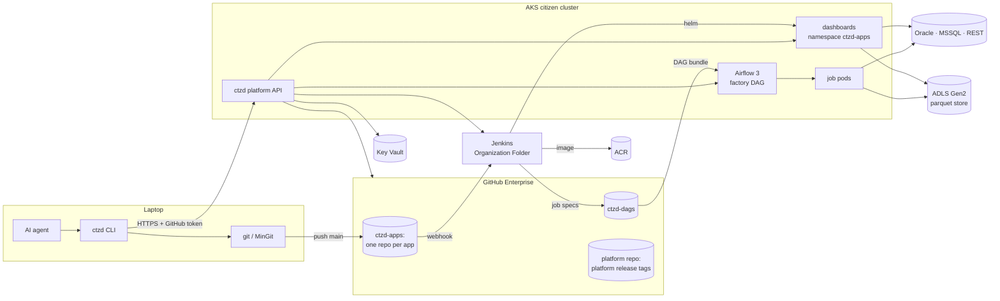
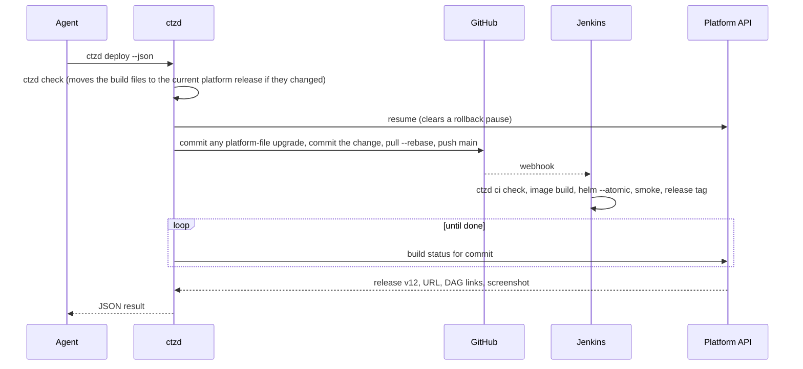

# ctzd platform plan

ctzd lets business users with no coding experience build Python dashboards and
scheduled jobs by talking to an AI coding agent, and get back a link to the
running app. The agent writes the code, runs the checks, and deploys. The user
never touches git, a pull request, a Dockerfile, or a terminal.

This page records the plan agreed on 2026-11-04 and revised on 2026-11-06:
what users experience, how the pieces fit, every decision with its reason, and
the rollout. The Jenkins and Kubernetes sections are proposals for the
infrastructure owner to confirm or change. All hostnames and organisation names
here are `contoso` placeholders. Version 0.2.0 of the CLI implements this plan;
section 14 says what has and has not been run.

## 1. What a citizen developer experiences

1. They install the `ctzd` skill from the internal skills app, or paste one
   sentence from the platform landing page into their agent:
   *"Set me up for ctzd: run `powershell -c "irm https://ctzd.contoso.com/install.ps1 | iex"`
   and do what it prints."*
2. The agent runs the install script. A browser tab opens once and asks them to
   approve GitHub access. They click **Authorize**.
3. They describe what they want: *"Build me a dashboard of today's bond prices
   by sector from the FI pricing database."* The agent runs `ctzd new`, writes
   the data loader, the logic, and the page, starts it locally with `ctzd dev`,
   and shows it to them.
4. They say *"ship it"*. The agent runs `ctzd deploy` and replies with
   `https://fi-bond-prices.ctzd.contoso.com` and a screenshot of the live page.
5. They say *"email me the sector summary every weekday at 7"*. The agent adds a
   job with `ctzd add job`, deploys, and replies with the link to the job in
   Airflow.
6. They say *"yesterday's change broke the chart"*. The agent runs
   `ctzd rollback`; the previous version is live within seconds, and the agent
   then fixes the change and deploys again.

Power users may run git themselves. Pushing to `main` deploys exactly as
`ctzd deploy` does.

## 2. Architecture



| Component | Runs on | Owner | In this repo |
|---|---|---|---|
| `ctzd` CLI | laptops and Jenkins agents | platform team | `packages/ctzd-cli` |
| `ctzd-core` runtime library (`import ctzd`) | inside every app | platform team | `packages/ctzd-core` |
| `ctzd-<sbu>` libraries | inside that SBU's apps | SBU champion | `kits/<sbu>` |
| Platform API | AKS | platform team | `packages/ctzd-api` |
| Platform releases: build files, agent guidance, starter code | served by the platform API from release tags | platform team, SBU champion for SBU skills | `packages/ctzd-cli/src/ctzd_cli/assets` |
| Bootstrap skill for the skills app | laptops | platform team | `bootstrap/` |
| Install script | laptops | platform team | `install/install.ps1` |
| Base image | ACR | platform team | `images/base` |
| Airflow factory DAG | Airflow | platform team | `airflow/` |
| Jenkins shared library | Jenkins | infrastructure owner (proposal) | `jenkins/` |
| Helm chart | AKS | infrastructure owner (proposal) | `deploy/helm/ctzd-app` |

## 3. Decisions

| Area | Decision | Reason |
|---|---|---|
| Users | Business users with no coding experience, on Windows laptops without admin rights or git, using any AI agent. Claude Code is the primary agent. | That is the audience. Everything below assumes the agent does every technical step. |
| Repos | One repo per app. An app is at most one dashboard plus any number of scheduled jobs that share its data and logic code. | Clear ownership, small agent context, and the job-plus-dashboard pair is the main speed tool. |
| Template | No Copier. Platform files are byte-identical in every app on the same platform release, and `ctzd sync` overwrites them. The app's Python package is always `app`. | Locked files never need a merge, so a template engine adds nothing. |
| Platform releases | Build files, agent guidance, and starter code ship together as numbered platform releases, separate from the CLI. A platform release never changes once published; its manifest names the minimum CLI and the minimum `ctzd-core`. Section 9 says how they are served and when each part moves. | Templates and skills change often, and reaching apps must not depend on people upgrading the CLI. |
| Build files | The locked files and the managed tables of `pyproject.toml` are pinned per app: `.ctzd/version` records the platform release they came from, and CI fails when they differ from it. They move to the channel's current platform release, newer or, after a revert, older, only when someone works on the app. Agents edit only `src/`, `tests/`, `app.toml`, `README.md`, and the dependency list. | Stops an agent from "fixing" a lint error by editing the Dockerfile or the linter config. A platform release cannot break the next build of an app nobody is working on. |
| Agent guidance | `AGENTS.md` and the skills are always the current platform release of the app's channel. `ctzd` writes them into the app folder, gitignored, and they are not drift-checked. | Guidance changes what the agent knows, not what is built, so a skill fix reaches every app within minutes with no commit and no deploy. |
| Platform release rollout | Two channels, pilot and general, each pointing at one platform release. Reverting a platform release moves the pointer back. | A bad skill reaches every agent at once; the pointer is the one-step undo. |
| Untouched apps | No bot commits and no scheduled rebuilds. An app nobody deploys keeps its platform release and its image; a patched base image reaches an app on its next build. | Accepted for v1; scheduled rebuilds would deploy changes nobody asked for. |
| CLI upgrades | The CLI never replaces itself. When the current platform release needs a newer CLI, commands stop and tell the agent to run `uv tool upgrade ctzd`. Jenkins uses one CLI version that the platform pins next to the chart version. | Replacing a running `ctzd.exe` on Windows is unproven, and the agent upgrading in a separate process avoids it. The platform's CLI always matches the chart and factory DAG it deploys with. |
| SBU stacks | One `ctzd-<sbu>` library per SBU, depending on `ctzd-core`, declaring the SBU's package stack and shared loaders. All published to the internal PyPI. | SBU differences live in packages, not in templates. |
| Dependencies | Agents may add any package from the internal PyPI. No cooldown, no allowlist. | The internal PyPI is the control point. |
| Deploy | `ctzd deploy` runs the checks, commits, pushes to `main`, follows the Jenkins build, and prints the URL. Nothing is built on the laptop. | Laptops have no Docker or registry access; CI is the only path to production. |
| Lanes | One lane: `main` is production. Only builds that pass every gate deploy. | Simplest model for people who will never review a pull request. |
| Rollback | Every successful deploy is a numbered release (`ctzd/vN` git tag holding the image and config). `ctzd rollback` restores an earlier release in seconds and pauses auto-deploy until the next `ctzd deploy`, which clears the pause after its checks pass and before it pushes. A successful build that produced no release is reported as not deployed. | Instant recovery without a rebuild; the pause stops the next push from bringing the bug back. Clearing it before the push means the build that push starts always deploys. |
| Failed rollouts | Helm `--atomic` with readiness probes; a release that never becomes ready is undone automatically. | Users never see a broken rollout. |
| Identity | One service identity for the whole platform. One read-only account per data source. An app's dashboard and job pods receive only the sources listed in its `[sources].use`, and an app may list any SBU's sources. | Simplicity, with a small blast radius: agent-written code on an open URL holds only its own sources' credentials. The SBU data boundary stays a convention, now visible in each `app.toml`. |
| Dashboard access | No sign-in on dashboards or the Airflow UI in v1. The Helm chart has an `auth` block, off by default, that adds ingress-nginx auth annotations for an oauth2-proxy set up for Entra ID; Airflow's ingress gets the same. App code never handles identity. | Internal network only; keep auth light. Company sign-in can be switched on at the ingress later without changing any app. |
| Platform login | GitHub device flow (`ctzd login`, one **Authorize** click). The token authenticates git and the platform API. Push access to a repo authorises every action on that app. | One login people already have. |
| Local credentials | `ctzd env` writes the read-only credentials of the app's sources into a gitignored `.env`. | Lets the agent run the app against real data locally. |
| Git on laptops | `ctzd setup` installs MinGit when git is missing. `ctzd` drives git; power users may use git directly. | Business users never see git; power users keep full control. |
| Jobs | A dedicated Airflow 3 in the citizen cluster. One factory DAG generates a DAG per job from specs Jenkins writes to `ctzd-dags`. No DAG code in app repos. The Airflow UI has no login. | People already use Airflow and want its DAG UI link; DAG code is too easy to get wrong. |
| Job outputs | Parquet on ADLS Gen2 at `<sbu>/<app>/<table>/`, written atomically by cluster jobs only, with the last versions kept. No writes back to source systems. | A job precomputes slow queries; the dashboard reads parquet in milliseconds. |
| Notifications | `ctzd.notify.email` (SMTP relay, DataFrames attached as xlsx or csv) and `ctzd.notify.teams` (Workflows webhook). Owners get an email when a job fails. | "Send me X every Monday" is the most common job. |
| Data stack | pandas 3 is the default. Oracle through `python-oracledb` thin mode, MSSQL through `mssql-python`, both fetching through Arrow. REST through the `ctzd-core` client. Floats are fine for numbers. | Most data comes from REST, Oracle, and MSSQL. Thin mode needs no Oracle client; no source needs Native Network Encryption. |
| Code layout | `src/app/data/` (the only I/O), `src/app/logic/` (pure functions), `src/app/ui/` and `src/app/jobs/` (entry points), enforced by import-linter. | Agents physically cannot put a query in a page callback. |
| UI frameworks | Streamlit (default) and Dash, chosen at `ctzd new`. | Both are in use; only `ui/` differs. |
| Python standards | ruff with every rule, ty with every rule as an error, both handled by the agent. Light data validation: loader schemas check required columns and dtypes only. 70% branch coverage on `logic/`. | Strict where the agent pays the cost, light where it would slow people down. Revisit the strict rules once the agent trials in [validation-plan.md](validation-plan.md) measure what they cost. |
| Tests | `ctzd check` runs the same gates locally and in Jenkins. Jenkins adds a post-deploy browser smoke test with a screenshot. Platform code has ordinary test suites. Agent trials against a local copy of the platform (`validation/`, [validation-plan.md](validation-plan.md)) check the CLI's output and the skills with real agents; they inform changes and are not a gate. | One definition of "green". Only an agent shows whether the skills and messages work for an agent. |
| Agent instructions | App folders have `AGENTS.md` and `.agents/skills/`, plus a copy of the skills in `.claude/skills/` because Claude Code does not read `.agents/skills/`. `ctzd` writes all three and the app's `.gitignore` lists them. | Agent-neutral guidance that every agent can read. |
| Skill distribution | The internal skills app carries one bootstrap skill, `ctzd`, which says only to run `ctzd setup --json` and follow `next`. Everything else is served with the platform release. | The bootstrap skill almost never changes; everything that does change has one update channel. |
| Enforcement | `ctzd deploy` runs `ctzd check` first; Jenkins runs it again. An org-wide Claude Code managed setting denies `Read(**/.env)`. | The checks work for every agent, without per-repo agent config. The `.env` rule is a speed bump: it blocks file commands such as `cat .env`, not a script that opens the file, so the read-only accounts are the real limit. |
| Command output | Every command prints a short summary; `--json` returns the same facts for agents. Failures name the failing step and show the last log lines. | Agents act on structured output; people read the summary. |
| Dashboards at rest | Always on, small resource requests. Streamlit runs one process per pod; Dash runs gunicorn with 2 workers and 4 threads. | Simple; add scale-to-zero only if node costs demand it. |
| Logs | `ctzd logs` streams pod logs through the platform API; job logs live in Airflow. No log shipping in v1. | No Datadog in this cluster yet. |
| Lifecycle | `ctzd delete` removes the app at once and its tables 30 days later. The SBU team inherits apps whose owner leaves. Pausing idle apps comes later, once something counts visits. | Keeps the store from filling with abandoned tables. v1 ships no logs to count visits from. |
| Repo access | Internal visibility; the creator is admin; the SBU's GitHub team has write. | Colleagues can take over an app. |
| Folders | Users keep apps in any folder they like. | Their choice. |
| Ownership | Platform team owns the platform; each SBU names a champion who owns its library and SBU skill; data sources are added by the platform team on the champion's request. | Agents can never add a data source themselves. |

## 4. An app repository

```text
fi-bond-prices/
├── app.toml                 # app settings: the agent edits this
├── pyproject.toml           # dependencies: the agent edits [project].dependencies only
├── uv.lock
├── README.md
├── src/app/
│   ├── data/                # loaders: the only code that does I/O
│   │   ├── loaders.py
│   │   └── sql/*.sql        # one query per file, bind parameters only
│   ├── logic/               # pure functions: frames in, frames out
│   ├── ui/main.py           # the Streamlit or Dash entry point
│   └── jobs/<name>.py       # one module per scheduled job, each with main() -> int
├── tests/
├── .env.example             # written by ctzd sync from [sources].use
├── AGENTS.md                # guidance: written by ctzd, gitignored
├── .agents/skills/          # guidance: written by ctzd, gitignored
├── .claude/skills/          # guidance: a copy for Claude Code, gitignored
├── Dockerfile  Jenkinsfile  # locked
├── ruff.toml  ty.toml  .importlinter  pytest.toml  .python-version  # locked
├── .pre-commit-config.yaml  .gitignore  .gitattributes  .dockerignore  # locked
└── .ctzd/version            # platform release the build files came from
```

The build files are the platform's: the locked files and the managed tables of
`pyproject.toml` (`build-system`, `requires-python`, `dependency-groups.dev`, and
`tool.uv`). They are committed and pinned to the platform release recorded in
`.ctzd/version`; `ctzd check` and Jenkins fail when any of them differ from that
release. The guidance (`AGENTS.md` and the skills) is not committed: `ctzd`
rewrites it from the channel's current platform release whenever it runs in the
app. Section 9 says when each part moves.

`app.toml` holds everything Jenkins and Airflow need:

```toml
[app]
name = "bond-prices"
sbu = "fi"
ui = "streamlit"          # streamlit | dash | none
size = "s"                # s | m | l
owners = ["ann.lee@contoso.com"]

[sources]
use = ["fi_pricing"]      # sources ctzd env writes into .env

[[jobs]]
name = "sector_summary"
schedule = "0 7 * * 1-5"  # cron, in the time zone below
timezone = "Europe/London" # IANA name; daylight saving included; default UTC
size = "m"
retries = 1
timeout_minutes = 60
```

import-linter enforces the layers: `ui` and `jobs` may import `data` and
`logic`; `data` and `logic` never import each other or anything above them;
`logic` imports no I/O library and no `ctzd`; `ui` never imports a database
driver or HTTP client directly.

## 5. The ctzd command line

| Command | What it does |
|---|---|
| `ctzd setup` | Checks uv, git (installing MinGit on Windows when missing), the GitHub login, and the agent setup; once all pass, returns `guide`, the start guide from the current platform release. |
| `ctzd login --start`, `ctzd login --wait` | GitHub device-flow login in two steps, because agents see output only when a command ends: `--start` returns the code to show the person, `--wait` blocks until they approve it. The token goes into the OS credential store. |
| `ctzd new NAME --sbu SBU --ui streamlit\|dash\|none` | Creates the GitHub repo through the platform API and writes the current platform release's starter app into a new folder. `--offline` writes the files only. |
| `ctzd open NAME --sbu SBU` | Clones an existing app into a new folder. |
| `ctzd dev [--port N]`, `ctzd dev --stop` | Starts the dashboard locally against real data in the background, on 8501 or the next free port, and returns its URL; run again, it restarts it. `--stop` stops it, so an agent never has to find and kill processes. |
| `ctzd exec -- COMMAND` | Runs a command in the app's environment with its source credentials, as `ctzd dev` does, such as a look at what a loader returns from the live source. Agents never read or load `.env` themselves. |
| `ctzd run JOB [--local] [--wait]` | Runs a job in Airflow and prints the run link, `--wait` follows it to success or failure; `--local` runs it on the laptop. |
| `ctzd add job NAME --schedule CRON [--timezone ZONE]` | Adds a job module, its test, and its `app.toml` entry; the schedule runs in ZONE (default UTC). |
| `ctzd check [--fast]` | Runs every gate, fixing formatting and simple lint locally; `--fast` skips the tests. |
| `ctzd sources` | Lists the data sources the platform has, by name. |
| `ctzd env` | Writes the app's read-only source credentials into `.env`. |
| `ctzd deploy` | Checks, commits, pushes, follows Jenkins, prints the URL, DAG links, and screenshot. |
| `ctzd status` | Current release, pause state, URL, DAG links, last build. |
| `ctzd logs [--job JOB] [--tail N]` | Recent dashboard or job log lines. |
| `ctzd releases` | Lists releases. |
| `ctzd rollback [vN]` | Restores a release and pauses auto-deploy. |
| `ctzd sync` | Brings the build files to the channel's current platform release and rewrites the guidance. |
| `ctzd delete --yes` | Deletes the app. |
| `ctzd ci …` | Steps Jenkins calls: `check`, `render`, `release`, `smoke`. |

Every command accepts `--json`. Exit status is `0` on success, `1` on failure,
`2` on a usage error.

Every command run inside an app refreshes its guidance, asking the platform API
for the current platform release at most every few minutes. When that release
needs a newer CLI, the command stops with exit status `1` and its `next` step
tells the agent to run `uv tool upgrade ctzd`.



## 6. Data access

**Sources.** Each data source is one Key Vault secret, `ctzd-source-<name>`,
holding a JSON description of the source and its read-only account. The
platform syncs each secret into its own Kubernetes secret, and an app's
dashboard and job pods receive the sources listed in its `[sources].use` as
environment variables named `CTZD_SOURCE_<NAME>`. `ctzd env` writes the same
variables into `.env` on the laptop. Supported kinds are
`oracle`, `mssql`, `rest` (no auth, bearer token, header key, basic, or OAuth
client credentials), and `teams` (a Workflows webhook). Adding a source is a
platform-team task.

**Queries.** Loaders call `ctzd.query("fi_pricing", "sql/prices.sql", {"as_of": day})`
and get a pandas DataFrame; decimals arrive as float64 and dates as datetime64.
SQL lives in files with bind parameters (`:name` for Oracle, `%(name)s` for
MSSQL) and selects only the columns it needs. REST loaders call
`ctzd.rest("fi_api").get_frame("/bonds", records="items")`, `get_json`,
`get_all_pages`, or `post_json`; the client applies timeouts, retries on
429 and 5xx, OAuth token refresh, and paging, and keeps connections open
between calls.

**Caching.** `@ctzd.cached(ttl="15m")` caches a loader's result in the process,
the same way in Streamlit and Dash. `ctzd-core` logs any dashboard loader slower
than 3 seconds; the skill tells the agent to move that query into a job.

**Store.** `ctzd.write_table(df, "sector_summary")` writes a new version of the
table and then flips its `_latest` pointer, so readers never see a half-written
table; `ctzd.read_table("sector_summary")` reads the latest version, and
`app=` reads another app's table. Locally, writes go to `.ctzd/out/`.

**Notifications.** `ctzd.notify.email(...)` and `ctzd.notify.teams(...)`.

**Validation.** `ctzd.require_columns(frame, {"isin": "str", "price": "float"})`
checks that the required columns exist with the expected dtype family (`str`,
`float`, `int`, `number`, `datetime`, `bool`, or `any`). Nothing heavier.

**Tests.** `ctzd.testing.fake_sources(fi_pricing={"sql/prices.sql": frame})`,
`fake_store(tmp_path)`, and `outbox()` replace sources, the store, and
notifications in tests; inside `fake_sources` any source that is not faked
fails, so a test never reaches a real system.

## 7. Quality gates

`ctzd check` runs, in order:

1. the build-file drift check against the app's recorded platform release
   (locally it restores changed files, and moves the app to the channel's
   current platform release when that release's build files differ);
2. `uv sync` (`uv sync --locked` in Jenkins);
3. `ruff format` and `ruff check --fix` (check-only in Jenkins), every rule;
4. `ty check`, every rule an error;
5. `lint-imports`, the layer contracts;
6. a parse of every `src/app/data/sql/*.sql` file as Oracle or SQL Server;
7. `pytest`, with branch coverage of `src/app/logic` at least 70%.

The starter tests include a Streamlit `AppTest` or Dash callback test that runs
the page against fake sources from `ctzd.testing`. Jenkins runs the same
`ctzd ci check`, and after the rollout a browser smoke test opens every page,
fails on an error box, saves a screenshot for the agent, and rolls the release
back if the page is broken.

## 8. Agent instructions and skills

Each app folder has a short `AGENTS.md` and these skills in `.agents/skills/`,
written by `ctzd` from the channel's current platform release:

| Skill | Teaches |
|---|---|
| `ctzd-workflow` | The dev → check → deploy → status → rollback loop and reading `--json` output. |
| `ctzd-layout` | Where code goes, with worked examples. |
| `ctzd-data` | Sources, SQL files, caching, REST, pandas 3 pitfalls, moving slow queries into jobs, the store. |
| `ctzd-streamlit`, `ctzd-dash` | Page structure, speed, and UI tests for each framework. |
| `ctzd-jobs` | Job entry points, schedules, notifications, safe reruns. |
| `ctzd-testing` | What to test and how to build small test frames. |
| `python-standards` | The house Python rules, trimmed for this audience. |
| `ctzd-troubleshoot` | Reading Jenkins, Airflow, and pod failures, with common fixes. |
| `sbu-<sbu>` | The SBU's sources, glossary, and shared loaders. |

Codex, Copilot, Cursor, Gemini CLI, and OpenCode read `.agents/skills/`. Claude
Code reads `AGENTS.md` (since version 2.1.277) unless a `CLAUDE.md` sits in the
working folder or above it, and it does not read `.agents/skills/`, so `ctzd`
also writes a `.claude/skills/` copy. All three are gitignored, and every `ctzd`
command run in the app refreshes them; Claude Code picks up a change in its next
session. `ctzd setup` warns when a `CLAUDE.md` in a parent folder would stop
Claude Code from reading `AGENTS.md`.

The internal skills app distributes only the bootstrap skill `ctzd`
(`bootstrap/skills/ctzd`), which says to run `ctzd setup --json`, follow its
`next` steps, and then read the `guide` it returns. That guide is
`start/GUIDE.md` from the current platform release, and it teaches logging in,
starting an app, and opening an existing one, so the bootstrap skill almost
never changes.

## 9. Onboarding, distribution, and platform releases

`install.ps1`, run by the agent, puts uv in `~/.local/bin`, writes a user
`uv.toml` that points at the internal PyPI and an internal mirror of uv's
Python builds, runs `uv tool install ctzd`, and runs `ctzd setup`. Setup
installs MinGit when git is missing and reports whether the person still needs
to log in, which the agent then does with the two-step `ctzd login`. The uv,
MinGit, and Python downloads are served from the platform host, so laptops
need no access to github.com or pypi.org.

**Platform releases.** A platform release bundles the build files (the locked
files and the managed `pyproject.toml` values), the agent guidance (`AGENTS.md`,
the common skills, and every SBU's skill), the starter code, and the start guide
`ctzd setup` returns. Its folder in the platform repo is
`packages/ctzd-cli/src/ctzd_cli/assets`, with the manifest `release.toml`
naming the release number, the minimum CLI, and the minimum `ctzd-core`.
Cutting a release is raising that number, committing, and tagging the commit
`platform-release/<n>`; a published release never changes. The CLI and Jenkins
fetch releases only through the platform API: `GET /v1/releases/current`
(with `sbu` and `app`, that app's channel; without, the general channel) and
`GET /v1/releases/{n}`. The API reads each tag's tarball once, checks that its
manifest carries the tag's number, and keeps it.

**Channels.** `channels.toml` on the platform repo's main branch points the
pilot and general channels at one platform release each, lists the apps on the
pilot channel, and names the newest published CLI for the upgrade hint.
Promoting or reverting a platform release is a reviewed commit that moves a
pointer; the API rereads the file every minute.

```toml
cli = "0.2.0"
[channels]
pilot = 2
general = 1
[pilot]
apps = ["fi-bond-prices"]
```

**Without the platform.** Every release the CLI fetches is kept under the ctzd
home folder. With no login, no network, or `--offline`, commands use that cache
and the seed release bundled in the CLI, which is the release folder it was
built from. Build files of a release that is not available that way are never
guessed at: the check fails and says to reconnect.

**What moves when.**

| Part | When an app moves to the channel's platform release |
|---|---|
| Guidance | Always the channel's current platform release. Every `ctzd` command in the app refreshes it; no commit, no deploy. |
| Build files | Only when someone works on the app and the channel's platform release has different build files, so a guidance-only release leaves `.ctzd/version` alone. `ctzd deploy` commits the upgrade on its own ("Upgrade platform files to platform release 43") before the person's change. The same commit raises `ctzd-core` and the SBU library in `uv.lock` to the release's minimum. |
| Starter code | Read at `ctzd new`. |

An app nobody works on keeps its platform release and its image.

**SBU skills** ship in the same platform release. Champions change
`skills/sbu/<sbu>/` through pull requests guarded by CODEOWNERS, and the
platform team cuts the release.

**The CLI** never replaces itself. When the current platform release needs a
newer CLI, commands stop and tell the agent to run `uv tool upgrade ctzd`, which
runs as a separate process; when a newer CLI exists but is not required, they
succeed with a hint. Jenkins uses one CLI version, pinned in its library next to
the chart version, and that CLI reads every platform release format still in
use. Dropping an old format is a deliberate, announced change.

## 10. Jobs on Airflow

Jenkins renders `app.toml` into `specs/<sbu>/<app>.json` (image, release, owners,
and each job's schedule, time zone, size, retries, and timeout) and commits it to the
`ctzd-dags` repo. The factory DAG in that repo reads every spec and generates
one DAG per job, named `<sbu>__<app>__<job>`, scheduled in the job's time zone
and each calling the job module's `main()` in the app's image with
KubernetesPodOperator and only the app's own sources. Calling `main()` rather
than running the module means a job without an `if __name__ == "__main__"`
guard still runs, and its exit code is the run's result.
A failed run emails the app's owners through the SMTP provider's
`SmtpNotifier`, which needs Airflow's `smtp_default` connection. A spec that
fails to parse is logged and skipped so the other apps' jobs keep running.
Because the specs live in the same git repository as the factory DAG, a
GitDagBundle version pins both together. `ctzd deploy` prints each DAG's link
and `ctzd run` triggers a run and prints its link. The Airflow UI runs the
simple auth manager in all-admins mode until company sign-in is switched on at
its ingress (section 11). The factory is tested by loading it in Airflow 3.3
(`airflow/tests`). A daily platform DAG in `ctzd-dags`, `ctzd_table_janitor`,
removes a deleted app's `<sbu>/<app>/` folder from the store 30 days after the
delete job records the deletion as `deleted/<sbu>/<app>.json` in `ctzd-dags`.
The record lives in git, which the delete job already writes, so Jenkins needs
no store credentials; the DAG reaches the store through Airflow's `ctzd_store`
connection.

## 11. Jenkins and Kubernetes (proposals for the infrastructure owner)

- **Discovery.** One GitHub Organization Folder job scans `ctzd-apps` and
  builds every repo with a `Jenkinsfile`. The `Jenkinsfile` is
  `@Library('ctzd') _` plus `ctzdApp()`.
- **Pipeline.** `ctzdApp()` installs the CLI version the platform pins next to
  the chart version into a per-build venv, runs `ctzd ci check` (which checks
  the build files against the app's recorded platform release), builds and pushes
  `contosoctzd.azurecr.io/apps/<sbu>-<app>:<sha>`, skips deploy if the app is
  paused, runs `helm upgrade --install --atomic` with values from
  `ctzd ci render`, runs `ctzd ci smoke` against the live URL (running
  `helm rollback` and failing the build if the page shows an error), commits
  the job specs to `ctzd-dags` only once the page has passed, so Airflow only
  runs the image of a release that went live, and finishes with `ctzd ci release`, which tags the
  commit `ctzd/vN`, and records the live release in the `ctzd-state-<sbu>-<app>`
  ConfigMap that the platform API reads. Branches other than `main` run the
  checks only.
- **Rollback job.** A parameterised `ctzd-rollback` job, triggered by the
  platform API, redeploys a release's image and config and sets the pause flag.
- **Branch protection.** `main` accepts direct pushes; force-pushes and
  deletion are blocked.
- **Cluster.** One `ctzd-apps` namespace. Sizes `s`, `m`, `l` map to
  0.5 CPU / 1 GiB, 1 CPU / 4 GiB, and 2 CPU / 8 GiB limits, with requests of
  0.1 CPU and 512 MiB. One replica per dashboard.
- **Ingress.** `https://<sbu>-<app>.ctzd.contoso.com` under one wildcard DNS
  record and one wildcard certificate. The chart's `auth` block (`enabled`,
  `url`, `signin`), off by default, adds ingress-nginx's `auth-url` and
  `auth-signin` annotations for an oauth2-proxy set up for Entra ID. The
  infrastructure owner sets it once in `platform-values.yaml`, and does the same
  for Airflow's ingress.
- **Secrets.** Each source's secret is synced from Key Vault into its own
  Kubernetes secret. `ctzd ci render` lists the app's sources, so its dashboard
  and job pods mount only those.
- **Images.** ACR keeps the last 20 images per app, which bounds rollback.
- **Pipeline smoke test.** Platform CI builds a sample app of each kind through
  the real pipeline into a throwaway namespace.

## 12. Ownership

| Who | Owns |
|---|---|
| Platform team | `ctzd`, `ctzd-core`, the platform API, platform releases and their channels, the template and common skills, the base image, Airflow, the install script, adding data sources |
| Infrastructure owner | Jenkins, the Helm chart, the cluster, DNS and certificates, secret sync, the sign-in proxy when it is switched on |
| SBU champion | `kits/<sbu>` and the `sbu-<sbu>` skill, through CODEOWNERS with platform review; the skill ships in the platform release |
| App owner | Their app, through their agent |

## 13. Rollout

| Phase | Scope | Exit gate |
|---|---|---|
| 0 | The platform team builds the platform and runs the spikes below. | A sample app of each kind deploys end to end. |
| 1 | FI (fixed income) pilots with 3–5 citizen developers building real apps. Skills are tuned from what goes wrong. | Pilot apps reach production without platform-team help. |
| 2 | All SBUs. | — |

Phase 0 spikes:

- `python-oracledb` thin-mode `fetch_df_all` and `mssql-python` `cursor.arrow()`
  against one real source each, over the company network with TLS (already run
  against local Oracle 23 Free and SQL Server 2022 containers; see section 14);
- Airflow 3: the UI link format (`/dags/<dag_id>/runs/<run_id>` is assumed),
  the trigger request body, and API tokens in all-admins mode;
- a Claude Code managed deny rule, `Read(**/.env)`, that matches `.env` in
  every project;
- whether Claude Code loads `AGENTS.md` and skills when the agent works in an
  app subfolder, and whether it loads skills from a gitignored
  `.claude/skills/` (Claude Code 2.1.319 on Linux loads both from a gitignored
  app folder when started in it; started in a parent folder, agents in the
  trials read the app's skills by path, as the start guide says; still to check
  on Windows);
- GitHub Enterprise device flow for the `ctzd` OAuth app;
- MinGit and uv on a locked-down laptop, and uv's Python downloads from an
  internal mirror.

## 14. Implementation status

Built and verified in this repository on 2026-11-04:

- the CLI, `ctzd-core`, and the platform API, with their test suites, under the
  house ruff and ty configuration;
- one app of each kind (Streamlit, Dash, jobs only) generated by `ctzd new`
  and passing every `ctzd check` gate (`scripts/e2e.sh`);
- app images built on the base image, run as the non-root user, and checked by
  `ctzd ci smoke`, which also caught a page that raises;
- the Helm chart linted and rendered with `ctzd ci render` output;
- the factory DAG loaded by Airflow 3.3.2 with the Kubernetes provider 10.25;
- the job-spec publisher run against a local git repository;
- `ctzd.query` against Oracle 23 Free (thin mode) and SQL Server 2022 in local
  containers (`scripts/driver-spike.sh`): 200,000 rows in 0.18 s and 0.09 s,
  named binds on both, decimals as float64, dates as datetime64, nulls kept.
  Oracle reports unquoted column names in upper case, so `ctzd.query`
  lower-cases them, as SQLAlchemy does.

Written but not yet run against real systems: the platform API's GitHub,
Jenkins, Airflow, Kubernetes, and Key Vault clients; the Jenkins library and
jobs; the device-flow login; the drivers over the company network; the store on
ADLS; `install.ps1` and MinGit on Windows.

Built on 2026-11-06 (CLI 0.2.0, chart 0.2.0) and tested with the fakes and a
real Airflow, not yet against the real services: platform releases with their
tags, channels, cache, and seed; the API's release endpoints; guidance written
into app folders and refreshed by every command; build-file upgrades in their
own commit, raising `ctzd-core` and the SBU library to the release's minimum;
commands stopping when a newer CLI is required; Jenkins using a CLI the
platform pins; the thin bootstrap skill with the served start guide; one
Kubernetes secret per source; the chart's `auth` block; `ctzd deploy` clearing
the rollback pause before it pushes and reporting a build that deployed nothing;
and the table janitor DAG with the delete job's deletion record.

Validated on 2026-11-06 with `validation/` (results in
[validation-plan.md](validation-plan.md) section 7): the CLI against the API
over HTTP; `ctzdApp()`, the rollback job, and the delete job on a real Jenkins
with docker, helm, and kubectl stubbed; the chart linted and rendered; and
agent trials (Haiku 5.5 and Sonnet 5.5, a simulated person) against a local
platform that runs the real API, CI steps, dashboards, and jobs. They found and
fixed bugs that predate this plan's revision, among them a library that did not
compile on Jenkins, a rollback job the Groovy sandbox rejected, and release tags
that were all numbered v1. Still not run: a real cluster (Helm install,
readiness, the factory DAG's pods), and every real service listed above.

## 15. Open items

- The FI package stack, first sources, and pilot apps.
- Rough numbers of SBUs, citizen developers, and apps for sizing Airflow and
  the cluster.
- Whether Excel users need job outputs in a SQL table; if so, add an MSSQL
  output database.
- Three choices were built as the simplest that works and are open to change:
  apps join the pilot channel by being listed in `channels.toml`; a platform
  release is cut by tagging and promoted by a commit to `channels.toml`; and
  without the platform the CLI uses its cache and the seed release it bundles.
