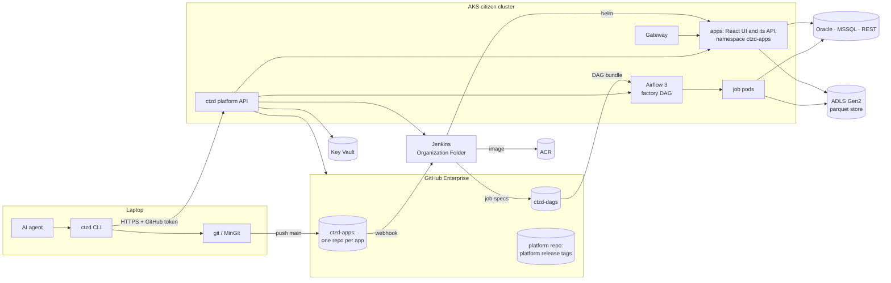
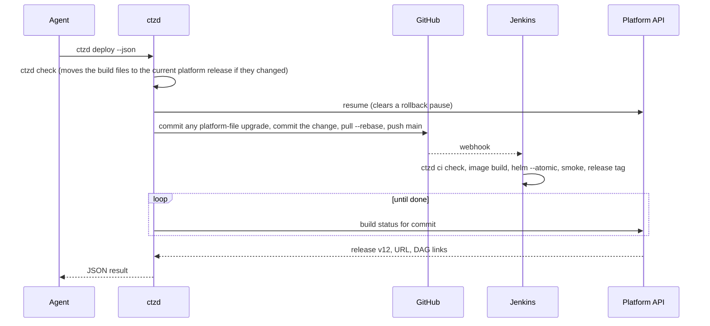

# ctzd platform plan

ctzd lets business users with no coding experience build dashboards and
scheduled jobs by talking to an AI coding agent, and get back a link to the
running app. The agent writes the code, runs the checks, and deploys. The user
never touches git, a pull request, a Dockerfile, or a terminal.

This page records the plan agreed on 2026-11-04 and revised on 2026-11-06 and
2026-11-07: what users experience, how the pieces fit, every decision with its
reason, and the rollout. The Jenkins and Kubernetes sections are proposals for
the infrastructure owner to confirm or change. All hostnames and organisation
names here are `contoso` placeholders.

The 2026-11-07 revision makes four decisions: an app's only UI is a React app
built on basis-ui with a basis-api backend, in one repo and one container
(Streamlit and Dash go); every number is a float64 that only the display
rounds; agents look at their pages only through `ctzd shot`, not in the deploy loop; and dashboards are reached
through Gateway API instead of an Ingress. Version 0.3.0 of the CLI implements
what section 14 lists as built: the React starter is `ctzd new`'s only
dashboard, built against basis's and basis-ui's main branches, and the
Streamlit and Dash starters are gone.

## 1. What a citizen developer experiences

1. They install the `ctzd` skill from the internal skills app, or paste one
   sentence from the platform landing page into their agent:
   *"Set me up for ctzd: run `powershell -c "irm https://ctzd.contoso.com/install.ps1 | iex"`
   and do what it prints."*
2. The agent runs the install script. A browser tab opens once and asks them to
   approve GitHub access. They click **Authorize**.
3. They describe what they want: *"Build me a dashboard of today's bond prices
   by sector from the FI pricing database."* The agent runs `ctzd new`, which
   writes a working app, mostly filled in. It asks at most a few questions about
   the business, builds the pages on fake data shaped like the real source,
   starts the app with `ctzd dev`, and gives them a link to open on their own
   machine. Once they like what they see, it switches the app to the real data
   and checks a number or two with them.
4. They say *"ship it"*. The agent runs `ctzd deploy` and replies with
   `https://fi-bond-prices.ctzd.contoso.com`.
5. They say *"email me the sector summary every weekday at 7"*. The agent adds a
   job with `ctzd add job`, deploys, and replies with the link to the job in
   Airflow.
6. They say *"yesterday's change broke the chart"*. The agent runs
   `ctzd rollback`; the previous version is live within seconds, and the agent
   then fixes the change and deploys again.

Power users may run git themselves. Pushing to `main` deploys exactly as
`ctzd deploy` does.

## 2. Architecture



| Component | Runs on | Owner | In this repo |
|---|---|---|---|
| `ctzd` CLI | laptops and Jenkins agents | platform team | `packages/ctzd-cli` |
| `ctzd-core` runtime library (`import ctzd`) | inside every app | platform team | `packages/ctzd-core` |
| `ctzd-<sbu>` libraries | inside that SBU's apps | SBU champion | `kits/<sbu>` |
| basis-api and basis-core, which `ctzd-core` builds on | inside every app | basis maintainers | no: the basis repo (section 16) |
| `@basis/ui` and `@basis/parallax`, which every page imports | inside every app | basis-ui maintainers | no: the basis-ui repo (section 16) |
| Platform API | AKS | platform team | `packages/ctzd-api` |
| Platform releases: build files, agent guidance, starter code | served by the platform API from release tags | platform team, SBU champion for SBU skills | `packages/ctzd-cli/src/ctzd_cli/assets` |
| Bootstrap skill for the skills app | laptops | platform team | `bootstrap/` |
| Install script | laptops | platform team | `install/install.ps1` |
| Base image | ACR | platform team | `images/base` |
| Airflow factory DAG | Airflow | platform team | `airflow/` |
| Jenkins shared library | Jenkins | infrastructure owner (proposal) | `jenkins/` |
| Helm chart | AKS | infrastructure owner (proposal) | `deploy/helm/ctzd-app` |

The citizen cluster and its pipeline stay separate from the engineering side's:
engineering apps deploy through berth to their own clusters, with review by
risk, and citizen apps never do. The two sides share libraries (basis and
basis-ui) and nothing else.

## 3. Decisions

| Area | Decision | Reason |
|---|---|---|
| Users | Business users with no coding experience, on Windows laptops without admin rights or git, using any AI agent. Claude Code is the primary agent, and citizen developers use the latest models. | That is the audience. Everything below assumes the agent does every technical step. |
| Repos | One repo per app. An app is at most one dashboard plus any number of scheduled jobs that share its data and logic code. | Clear ownership, small agent context, and the job-plus-dashboard pair is the main speed tool. |
| UI | One kind of dashboard: a React app on `@basis/ui` and `@basis/parallax`, whose data comes from a basis-api backend in the same repo. One image holds both, and one process serves the API under `/api` and the built UI at `/`, on one origin. Streamlit and Dash were removed on 2026-11-07. | The latest models write React well. basis-ui's themed, prebuilt components and parallax's grid, pivot and charts give every app the firm's look and its number and date rules without design work, and one UI means one set of skills. |
| API | Every route of an app's API is a read-only dataset: parameters in, a table out, served as Arrow for parallax and as JSON. No route writes. | Sources are read-only, so an app has nothing to write; one pattern is one thing for the agent to learn. Writes happen only in jobs. |
| Numbers | Every number is a float64 from the source to the browser, `NaN` where it is missing; ids are text. Python never rounds or formats a number: the page rounds once, at display, by Excel's rule (15 significant digits, half away from zero, then the shown decimals), and `ctzd.display` writes numbers into messages by the same rule. `ctzd check` refuses rounding in an app's Python and SQL. | One simple type that pandas, numpy, Arrow, and the browser all hold natively. One rule in one place means a number reads the same in the page, an export, and an email, and the same as in Excel, where the firm's users live. Section 6 has the details. |
| Screenshots | After changing a page, the agent runs `ctzd shot`, which loads the page `ctzd dev` serves in a headless browser (on Windows, the Edge every laptop has), waits for parallax to draw, writes a PNG the agent looks at, and lists each problem: errors, failed requests, and a grid or chart that drew nothing or too small. It is not a gate in `ctzd check`, and deploys and the smoke test take no screenshots. | Decided on 2026-11-07 without screenshots, and reversed the same day by the maintainer: a code check cannot see a chart that draws an empty or squashed canvas, which the first React starter did. Edge means nothing to download on a laptop. |
| Libraries | `ctzd-core` wraps basis-core and basis-api: citizen Python imports only `ctzd`. Citizen pages import `@basis/ui` and `@basis/parallax` directly. Each platform release pins one basis version and one basis-ui version. ctzd never runs the `basis` command or `vp run sync`. | The Python wrapper keeps basis free to change; wrapping 60 React components would add nothing. The pins mean nothing reaches an app until a platform release names it. Section 16 has the coupling. |
| Template | No Copier. Platform files are byte-identical in every app on the same platform release, and `ctzd sync` overwrites them. The app's Python package is always `app`. | Locked files never need a merge, so a template engine adds nothing. |
| Platform releases | Build files, agent guidance, and starter code ship together as numbered platform releases, separate from the CLI. A platform release never changes once published; its manifest names the minimum CLI and the minimum `ctzd-core`. Section 9 says how they are served and when each part moves. | Templates and skills change often, and reaching apps must not depend on people upgrading the CLI. |
| Build files | The locked files and the managed tables of `pyproject.toml` are pinned per app: `.ctzd/version` records the platform release they came from, and CI fails when they differ from it. They move to the channel's current platform release, newer or, after a revert, older, only when someone works on the app. Agents edit only the app's code, `app.toml`, `README.md`, and the dependency lists. | Stops an agent from "fixing" a lint error by editing the Dockerfile or the linter config. A platform release cannot break the next build of an app nobody is working on. |
| Agent guidance | `AGENTS.md` and the skills are always the current platform release of the app's channel. `ctzd` writes them into the app folder, gitignored, and they are not drift-checked. | Guidance changes what the agent knows, not what is built, so a skill fix reaches every app within minutes with no commit and no deploy. |
| Platform release rollout | Two channels, pilot and general, each pointing at one platform release. Reverting a platform release moves the pointer back. | A bad skill reaches every agent at once; the pointer is the one-step undo. |
| Untouched apps | No bot commits and no scheduled rebuilds. An app nobody deploys keeps its platform release and its image; a patched base image reaches an app on its next build. | Accepted for v1; scheduled rebuilds would deploy changes nobody asked for. |
| CLI upgrades | The CLI never replaces itself. When the current platform release needs a newer CLI, commands stop and tell the agent to run `uv tool upgrade ctzd`. Jenkins uses one CLI version that the platform pins next to the chart version. | Replacing a running `ctzd.exe` on Windows is unproven, and the agent upgrading in a separate process avoids it. The platform's CLI always matches the chart and factory DAG it deploys with. |
| SBU stacks | One `ctzd-<sbu>` library per SBU, depending on `ctzd-core`, declaring the SBU's package stack, shared loaders, and column kinds. All published to the internal registry. | SBU differences live in packages, not in templates. |
| Dependencies | Agents may add any Python or npm package from the internal registry (an Artifactory instance that serves PyPI, npm, and the tool downloads), through `ctzd add package`. No cooldown, no allowlist. | The internal registry is the control point, and one command for both languages keeps agents off npm, pnpm, and uv directly. |
| Deploy | `ctzd deploy` runs the checks, commits, pushes to `main`, follows the Jenkins build, and prints the URL. Nothing is built on the laptop. | Laptops have no Docker or registry access; CI is the only path to production. |
| Lanes | One lane: `main` is production. Only builds that pass every gate deploy. | Simplest model for people who will never review a pull request. |
| Rollback | Every successful deploy is a numbered release (`ctzd/vN` git tag holding the image and config). `ctzd rollback` restores an earlier release in seconds and pauses auto-deploy until the next `ctzd deploy`, which clears the pause after its checks pass and before it pushes. A successful build that produced no release is reported as not deployed. | Instant recovery without a rebuild; the pause stops the next push from bringing the bug back. Clearing it before the push means the build that push starts always deploys. |
| Failed rollouts | Helm `--atomic` with readiness probes; a release that never becomes ready is undone automatically. | Users never see a broken rollout. |
| Identity | One service identity for the whole platform. One read-only account per data source. An app's dashboard and job pods receive only the sources listed in its `[sources].use`, and an app may list any SBU's sources. | Simplicity, with a small blast radius: agent-written code on an open URL holds only its own sources' credentials. The SBU data boundary stays a convention, now visible in each `app.toml`. |
| Dashboard access | No sign-in on dashboards or the Airflow UI in v1. The Helm chart's `auth` block, off by default, adds sign-in with Entra ID at the Gateway. App code never handles identity; the React shell runs with an anonymous user. | Internal network only; keep auth light. Company sign-in can be switched on at the Gateway later without changing any app. |
| Platform login | GitHub device flow (`ctzd login`, one **Authorize** click). The token authenticates git and the platform API. Push access to a repo authorises every action on that app. | One login people already have. |
| Local credentials | `ctzd env` writes the read-only credentials of the app's sources into a gitignored `.env`. | Lets the agent run the app against real data locally. |
| Git on laptops | `ctzd setup` installs MinGit when git is missing. `ctzd` drives git; power users may use git directly. | Business users never see git; power users keep full control. |
| Jobs | A dedicated Airflow 3 in the citizen cluster. One factory DAG generates a DAG per job from specs Jenkins writes to `ctzd-dags`. No DAG code in app repos. The Airflow UI has no login. | People already use Airflow and want its DAG UI link; DAG code is too easy to get wrong. |
| Job outputs | Parquet on ADLS Gen2 at `<sbu>/<app>/<table>/`, written atomically by cluster jobs only, with the last versions kept. No writes back to source systems. | A job precomputes slow queries; the dashboard reads parquet in milliseconds. |
| Notifications | `ctzd.notify.email` (SMTP relay, DataFrames attached as xlsx or csv) and `ctzd.notify.teams` (Workflows webhook). Owners get an email when a job fails. | "Send me X every Monday" is the most common job. |
| Data stack | pandas 3 is the default. Oracle through `python-oracledb` thin mode, MSSQL through `mssql-python`, both fetching through Arrow. REST through the `ctzd-core` client. | Most data comes from REST, Oracle, and MSSQL. Thin mode needs no Oracle client; no source needs Native Network Encryption. |
| Code layout | `src/app/data/` (the only I/O), `src/app/logic/` (pure functions), `src/app/api/` and `src/app/jobs/` (entry points), and `web/` (the pages), enforced by import-linter and basis-ui's lint. | Agents physically cannot put a query in a page or a route. |
| Python | Python 3.14, which basis requires, from the platform's mirror of uv's Python builds. Airflow's own project stays on 3.13. | One version across ctzd and basis. |
| Python standards | ruff with every rule, ty with every rule as an error, both handled by the agent. Light data validation: loader schemas check required columns and dtypes only. 70% branch coverage on `logic/`. | Strict where the agent pays the cost, light where it would slow people down. Revisit the strict rules once the agent trials in [validation-plan.md](validation-plan.md) measure what they cost. |
| Tests | `ctzd check` runs the same gates locally and in Jenkins. Jenkins adds a post-deploy smoke test in a headless browser that fails, and rolls the release back, on an error, a failed request, or a page that never loads; it takes no screenshot. Platform code has ordinary test suites. Agent trials against a local copy of the platform (`validation/`, [validation-plan.md](validation-plan.md)) check the CLI's output and the skills with real agents; they inform changes and are not a gate. | One definition of "green". Only an agent shows whether the skills and messages work for an agent. |
| Agent instructions | App folders have `AGENTS.md` and `.agents/skills/`, plus a copy of the skills in `.claude/skills/` because Claude Code does not read `.agents/skills/`. `ctzd` writes all three and the app's `.gitignore` lists them. | Agent-neutral guidance that every agent can read. |
| Skill distribution | The internal skills app carries one bootstrap skill, `ctzd`, which says only to run `ctzd setup --json` and follow `next`. Everything else is served with the platform release. No MCP server. | The bootstrap skill almost never changes; everything that does change has one update channel. Every agent reads MCP settings from a different file, while every agent runs a command. |
| Enforcement | `ctzd deploy` runs `ctzd check` first; Jenkins runs it again. An org-wide Claude Code managed setting denies `Read(**/.env)`. | The checks work for every agent, without per-repo agent config. The `.env` rule is a speed bump: it blocks file commands such as `cat .env`, not a script that opens the file, so the read-only accounts are the real limit. |
| Command output | Every command prints a short summary; `--json` returns the same facts for agents. Failures name the failing step and show the last log lines, and a check lists at most a screenful of problems, each with its fix. | Agents act on structured output; people read the summary. |
| Dashboards at rest | Always on, small resource requests, one process per pod serving the API and the built UI. | Simple; add scale-to-zero only if node costs demand it. |
| Logs | `ctzd logs` streams pod logs through the platform API; job logs live in Airflow. No log shipping in v1. | No Datadog in this cluster yet. |
| Lifecycle | `ctzd delete` removes the app at once and its tables 30 days later. The SBU team inherits apps whose owner leaves. Pausing idle apps comes later, once something counts visits. | Keeps the store from filling with abandoned tables. v1 ships no logs to count visits from. |
| Repo access | Internal visibility; the creator is admin; the SBU's GitHub team has write. | Colleagues can take over an app. |
| Folders | Users keep apps in any folder they like. | Their choice. |
| Ownership | Platform team owns the platform; each SBU names a champion who owns its library and SBU skill; data sources are added by the platform team on the champion's request. | Agents can never add a data source themselves. |

## 4. An app repository

The layout of an app once the React starter lands (paths under `web/` settle
when the starter is built against basis-ui's template):

```text
fi-bond-prices/
├── app.toml                 # app settings: the agent edits this
├── pyproject.toml           # Python dependencies: the agent edits [project].dependencies only
├── uv.lock
├── README.md
├── src/app/
│   ├── data/                # loaders: the only code that does I/O
│   │   ├── loaders.py
│   │   └── sql/*.sql        # one query per file, bind parameters only
│   ├── logic/               # pure functions: frames in, frames out
│   ├── api/datasets.py      # read-only datasets: parameters in, a table out
│   └── jobs/<name>.py       # one module per scheduled job, each with main() -> int
├── web/
│   ├── package.json         # npm dependencies: the agent edits "dependencies" only
│   ├── pnpm-lock.yaml
│   └── src/
│       ├── routes/*.tsx     # one page per route, on @basis/ui and @basis/parallax
│       └── api/generated/   # the client ctzd generates from the API; never edited
├── tests/                   # Python tests: logic, loaders, datasets, jobs
├── fixtures/                # synthetic rows the fake sources serve, in git
├── .env.example             # written by ctzd sync from [sources].use
├── AGENTS.md                # guidance: written by ctzd, gitignored
├── .agents/skills/          # guidance: written by ctzd, gitignored
├── .claude/skills/          # guidance: a copy for Claude Code, gitignored
├── Dockerfile  Jenkinsfile  # locked
├── ruff.toml  ty.toml  .importlinter  pytest.toml  .python-version  # locked
├── web/vite.config.ts  web/tsconfig.json  web/src/styles.css        # locked: the lines basis-ui's README gives
├── .pre-commit-config.yaml  .gitignore  .gitattributes  .dockerignore  # locked
└── .ctzd/version            # platform release the build files came from
```

The build files are the platform's: the locked files and the managed tables of
`pyproject.toml` (`build-system`, `requires-python`, `dependency-groups.dev`, and
`tool.uv`), and of `web/package.json` once it exists. They are committed and
pinned to the platform release recorded in `.ctzd/version`; `ctzd check` and
Jenkins fail when any of them differ from that release. The guidance
(`AGENTS.md` and the skills) is not committed: `ctzd` rewrites it from the
channel's current platform release whenever it runs in the app. Section 9 says
when each part moves.

`app.toml` holds everything Jenkins and Airflow need:

```toml
[app]
name = "bond-prices"
sbu = "fi"
ui = "react"              # react | none
size = "s"                # s | m | l
owners = ["ann.lee@contoso.com"]

[sources]
use = ["fi_pricing"]      # sources ctzd env writes into .env

[[jobs]]
name = "sector_summary"
schedule = "0 7 * * 1-5"  # cron, in the time zone below
timezone = "Europe/London" # IANA name; daylight saving included; default UTC
size = "m"
retries = 1
timeout_minutes = 60
```

import-linter enforces the Python layers: `api` and `jobs` may import `data`
and `logic`; `data` and `logic` never import each other or anything above them;
`logic` imports no I/O library and no `ctzd`; `api` never imports a database
driver or HTTP client directly. basis-ui's lint keeps pages to the generated
client and to the theme's components and tokens.

## 5. The ctzd command line

| Command | What it does |
|---|---|
| `ctzd setup` | Checks uv, git (installing MinGit on Windows when missing), the GitHub login, and the agent setup; once all pass, returns `guide`, the start guide from the current platform release. |
| `ctzd login --start`, `ctzd login --wait` | GitHub device-flow login in two steps, because agents see output only when a command ends: `--start` returns the code to show the person, `--wait` blocks until they approve it. The token goes into the OS credential store. |
| `ctzd new NAME --sbu SBU --ui react\|none` | Creates the GitHub repo through the platform API and writes the current platform release's starter app into a new folder: for `react`, a working app with the shell, a grid page, a chart page and a filter bar on fake data. `--offline` writes the files only. |
| `ctzd open NAME --sbu SBU` | Clones an existing app into a new folder. |
| `ctzd dev [--port N] [--fake]`, `ctzd dev --stop` | Starts the app locally in the background, against real data or, with `--fake`, the rows in `fixtures/SOURCE/NAME.csv` in place of every source, and returns its URL; run again, it restarts it. For a React app it runs the API and the page server together and regenerates the client when the API changes. `--stop` stops it, so an agent never has to find and kill processes. |
| `ctzd shot [PATH]` | A picture of a page `ctzd dev` serves (default `/`), under `.ctzd/shots/`, and each problem on it, one line each. Not a gate. |
| `ctzd exec -- COMMAND` | Runs a command in the app's environment with its source credentials, as `ctzd dev` does, such as a look at what a loader returns from the live source. Agents never read or load `.env` themselves. |
| `ctzd add dataset NAME [--source SRC]` | Writes a dataset's row type, loader, SQL file (with `--source`, which it lists in `app.toml`), and test, and regenerates the client. |
| `ctzd add page NAME --dataset NAME` | Writes a page showing the dataset as a bar chart and a grid, with each column's format from its row type, routes it, and links it from the header. |
| `ctzd api list` | Each dataset with its route, client function, parameters, and columns with their formats, so an agent never reads the generated client. |
| `ctzd add package NAME [--npm]` (planned) | Adds a Python or npm package from the internal registry. |
| `ctzd docs ui [COMPONENT]` | The component catalogue of the installed `@basis/ui` (`catalogue.json`, basis-ui step 1.15), by family, or one component's props, variants, and example. |
| `ctzd run JOB [--local] [--wait]` | Runs a job in Airflow and prints the run link, `--wait` follows it to success or failure; `--local` runs it on the laptop. |
| `ctzd add job NAME --schedule CRON [--timezone ZONE]` | Adds a job module, its test, and its `app.toml` entry; the schedule runs in ZONE (default UTC). |
| `ctzd check [--fast]` | Runs every gate, fixing formatting and simple lint locally; `--fast` skips the tests. |
| `ctzd sources` | Lists the data sources the platform has, by name. |
| `ctzd env` | Writes the app's read-only source credentials into `.env`. |
| `ctzd deploy` | Checks, commits, pushes, follows Jenkins, prints the URL and DAG links. |
| `ctzd status` | Current release, pause state, URL, DAG links, last build. |
| `ctzd logs [--job JOB] [--tail N]` | Recent dashboard or job log lines. |
| `ctzd releases` | Lists releases. |
| `ctzd rollback [vN]` | Restores a release and pauses auto-deploy. |
| `ctzd sync` | Brings the build files to the channel's current platform release and rewrites the guidance. |
| `ctzd delete --yes` | Deletes the app. |
| `ctzd ci …` | Steps Jenkins calls: `check`, `render`, `release`, `smoke`. |

Every command accepts `--json`. Exit status is `0` on success, `1` on failure,
`2` on a usage error.

Every command run inside an app refreshes its guidance, asking the platform API
for the current platform release at most every few minutes. When that release
needs a newer CLI, the command stops with exit status `1` and its `next` step
tells the agent to run `uv tool upgrade ctzd`.



## 6. Data access

**Sources.** Each data source is one Key Vault secret, `ctzd-source-<name>`,
holding a JSON description of the source and its read-only account. The
platform syncs each secret into its own Kubernetes secret, and an app's
dashboard and job pods receive the sources listed in its `[sources].use` as
environment variables named `CTZD_SOURCE_<NAME>`. `ctzd env` writes the same
variables into `.env` on the laptop. Supported kinds are
`oracle`, `mssql`, `rest` (no auth, bearer token, header key, basic, or OAuth
client credentials), and `teams` (a Workflows webhook). Adding a source is a
platform-team task.

**Queries.** Loaders call `ctzd.query("fi_pricing", "sql/prices.sql", {"as_of": day})`
and get a pandas DataFrame; numbers arrive as float64 and dates as datetime64.
SQL lives in files with bind parameters (`:name` for Oracle, `%(name)s` for
MSSQL) and selects only the columns it needs. REST loaders call
`ctzd.rest("fi_api").get_frame("/bonds", records="items")`, `get_json`,
`get_all_pages`, or `post_json`; the client applies timeouts, retries on
429 and 5xx, OAuth token refresh, and paging, and keeps connections open
between calls.

**Numbers.** Every number is a numpy float64, `NaN` where it is missing, from
the source to the browser, whose numbers are float64 too. A float64 is treated
as Excel treats one: a decimal known to 15 significant digits. Any decimal of
15 significant digits or fewer, such as a price of 99.84375 or an amount to the
cent below ten trillion, arrives unchanged, and the error that arithmetic adds
stays below the 15th digit, where display hides it.

- Every frame `ctzd-core` returns or stores holds its numbers as float64:
  `ctzd.query`, the fake sources in tests, REST responses, and the store, in
  both directions. Decimals become the float64 nearest their value, through
  their text, because pyarrow's direct cast is not correctly rounded (it turns
  2.675 into 2.6750000000000003). Oracle's `NUMBER(p,s)` is fetched as an exact
  decimal for that reason. Integers become float64, exact up to 2**53. Single
  precision values become the float64 of their shortest text, so 0.1 stays 0.1.
- Identifiers, such as security ids and account numbers, are text, selected as
  text in SQL (`TO_CHAR(id)`, `CAST(id AS VARCHAR(40))`). A whole-number column
  holding a value beyond 2**53 fails the query, naming the column, with that fix
  and the one for an amount (`CAST(x AS BINARY_DOUBLE)` or `CAST(x AS FLOAT)`).
- Rates and spreads are fractions: 0.0525 is 5.25% and 525 bp, as Excel stores
  percentages and as basis-ui's formatter reads them. Prices are per 100 of par.
  Loaders convert a source's units by dividing by 100 or 10,000.
- Python never rounds a number or formats one as text. `ctzd check` refuses
  `round()`, `.round()`, numpy's rounding, the `decimal` module, number formats
  in f-strings, `format()`, `str.format()` and `%`, and `float_format=` in an
  app's Python outside the page code; and `ROUND`, casts to a decimal type with
  a precision or to money, `TO_CHAR` with a number format, `FORMAT` of a number,
  and `STR` in its SQL. Each error says to leave the number to the page, or to
  `ctzd.display` in a message.
- The page rounds once, at display, by the rule parallax's formatter
  implements: 15 significant digits, half away from zero, then the shown
  decimals, half away from zero; a value that rounds to zero shows no minus
  sign. So 2.675 shows as 2.68, where JavaScript's `toFixed` gives 2.67, and
  0.1 + 0.2 shows as 0.3. Totals on a page come from parallax's exact sums.
- `ctzd.display` is a Python port of the same formatter, tested against the
  cases parallax's Rust writes, for numbers a job writes into an email or a
  Teams message: `ctzd.display.number(value, decimals=2)`,
  `ctzd.display.percent(...)`, `ctzd.display.bps(...)`, and
  `ctzd.display.money(value, "USD")`. Excel attachments carry the raw floats.
- Missing and infinite values are null on the wire, JSON and Arrow alike, and
  show blank.

**Datasets** (planned, with the React starter). A dataset is a function in
`src/app/api/datasets.py` that takes the page's parameters and returns a frame,
declared with `@ctzd.dataset` and a row type whose number columns name their
display kind: `ctzd.Price`, `ctzd.Price32`, `ctzd.Bps`, `ctzd.Pct`,
`ctzd.Money("USD")`, or `ctzd.Number(decimals=0)`, all plain floats at run
time. `ctzd-core` builds the basis-api route from it, checks the frame once
against the row type, and serves it as Arrow, carrying each column's display
format in the field metadata `basis.format`, and as JSON. parallax and
`@basis/ui`'s number components format each column by that metadata, so a page
never chooses decimals, and an SBU library can add its own kinds.

**Caching.** `@ctzd.cached(ttl="15m")` caches a loader's result in the process.
`ctzd-core` logs any loader slower than 3 seconds; the skill tells the agent to
move that query into a job.

**Store.** `ctzd.write_table(df, "sector_summary")` writes a new version of the
table and then flips its `_latest` pointer, so readers never see a half-written
table; `ctzd.read_table("sector_summary")` reads the latest version, and
`app=` reads another app's table. Locally, writes go to `.ctzd/out/`.

**Notifications.** `ctzd.notify.email(...)` and `ctzd.notify.teams(...)`.

**Validation.** `ctzd.require_columns(frame, {"isin": "str", "price": "float"})`
checks that the required columns exist with the expected dtype family (`str`,
`float` for every number, `datetime`, `bool`, or `any`). Nothing heavier.

**Tests.** `ctzd.testing.fake_sources(fi_pricing={"sql/prices.sql": frame})`,
`fake_store(tmp_path)`, and `outbox()` replace sources, the store, and
notifications in tests; inside `fake_sources` any source that is not faked
fails, so a test never reaches a real system.

## 7. Quality gates

`ctzd check` runs, in order:

1. the build-file drift check against the app's recorded platform release
   (locally it restores changed files, and moves the app to the channel's
   current platform release when that release's build files differ);
2. `uv sync` (`uv sync --locked` in Jenkins);
3. `ruff format` and `ruff check --fix` (check-only in Jenkins), every rule;
4. `ty check`, every rule an error;
5. `lint-imports`, the layer contracts;
6. a parse of every `src/app/data/sql/*.sql` file as Oracle or SQL Server;
7. the numbers gate: no rounding or number formatting in the app's Python
   outside the page code, or in its SQL (section 6);
8. `pytest`, with branch coverage of `src/app/logic` at least 70%.

With the React starter, the same command adds basis-ui's gates through `vp`:
formatting, Oxlint at basis-ui's settings, and TypeScript; a check that the
generated client matches the API; the pages' tests, which run without a
browser; and each dataset run once against the fake sources, its frame checked
against its row type, with no infinities and no more rows than parallax holds.
Laptops need no Chromium for the checks; `ctzd shot` uses Edge on Windows.

Jenkins runs the same `ctzd ci check`, and after the rollout a smoke test opens
every page in a headless browser and fails, rolling the release back, on an
error, a request that answers with a server error, or a page that does not
finish loading. It takes no screenshot.

## 8. Agent instructions and skills

Each app folder has a short `AGENTS.md` and skills in `.agents/skills/`,
written by `ctzd` from the channel's current platform release.

Codex, Copilot, Cursor, Gemini CLI, and OpenCode read `.agents/skills/`. Claude
Code reads `AGENTS.md` (since version 2.1.277) unless a `CLAUDE.md` sits in the
working folder or above it, and it does not read `.agents/skills/`, so `ctzd`
also writes a `.claude/skills/` copy. All three are gitignored, and every `ctzd`
command run in the app refreshes them; Claude Code picks up a change in its next
session. `ctzd setup` warns when a `CLAUDE.md` in a parent folder would stop
Claude Code from reading `AGENTS.md`.

The internal skills app distributes only the bootstrap skill `ctzd`
(`bootstrap/skills/ctzd`), which says to run `ctzd setup --json`, follow its
`next` steps, and then read the `guide` it returns. That guide is
`start/GUIDE.md` from the current platform release, and it teaches logging in,
starting an app, and opening an existing one, so the bootstrap skill almost
never changes.

**How the guidance is designed.** The agent trials (validation-plan section 7)
showed that agents scored lowest on talking with the person, and that almost
every broken rule came from an agent with no sanctioned way to do what it
needed, such as reading `.env` to see live data before `ctzd exec` existed. So
the guidance is the smallest part of the system:

- **Every rule has a command behind it.** Commands do each step (`ctzd dev`,
  `ctzd exec`, `ctzd add package`); generators write working code
  (`ctzd add dataset`, `ctzd add page`); checks fail with the fix in the
  message; and every result's `next` says what to do. The guidance holds only
  what nothing else can: the order of work, how to talk with the person, and
  where to look.
- **The core loop is in `AGENTS.md`,** which is always loaded, because every
  task needs it and skills load only when a task matches.
- **One pattern for the API.** Every route is a read-only dataset.
- **One command per vertical slice.** A visible change touches the SQL, the
  loader, the dataset, the generated client, and the page; `ctzd add dataset`
  and `ctzd add page` write all of it, and `ctzd dev` and `ctzd check`
  regenerate the client, so the agent edits only the SQL and the page.
- **Teach only what differs from what the model already knows.** `@basis/ui`
  keeps shadcn's names and props, TanStack, and Tailwind, so the skills cover
  only the differences: components cannot be restyled, colours and spacing come
  from the theme's tokens, every chart is parallax, data comes only through the
  generated hooks, and pages never format numbers.
- **Load little.** The component catalogue is generated from the pinned
  `@basis/ui`, and `ctzd docs ui` gives one component's detail. The guidance
  names what not to read: `node_modules/`, the generated client, the lockfiles.
- **Every page shows its source and the time its data was current,** and the
  starter's sample pages are marked, so `ctzd deploy` refuses while one is left
  unchanged.

**The order of work for a person who does not code**, taught in `AGENTS.md`
and `ctzd-workflow`:

1. Ask at most three things, all about the business: what question the page
   answers, who looks at it and how often, and which numbers matter.
2. Find the source (the `sbu-<sbu>` skill, `ctzd sources`) and look at the real
   columns, so the fake data has their shape.
3. Build the pages on fake data, run `ctzd dev --fake`, and give the person the
   local link, within minutes.
4. Change the pages until they say "yes, that".
5. Switch to the real data and check it: show one or two numbers and ask
   whether they match what the person sees elsewhere.
6. Deploy when they say so, and give them the live link.
7. Offer the obvious next step, such as emailing it every morning, without
   pushing.

**Skills with the React starter:**

| Skill | Teaches |
|---|---|
| `ctzd-workflow` | The order of work, the dev → check → deploy → status → rollback loop, and reading `--json` output; `talking.md` beside it gives good and bad replies by situation. |
| `ctzd-pages` | The shell, routes, and what differs from shadcn; `components.md`, generated from `@basis/ui`; `charts.md`, the chart for each kind of question ("over time" is a line, "against the curve" a scatter); and `recipes/`, working pages: grid, chart, KPIs, detail, filters, comparison. |
| `ctzd-data` | Sources, SQL files, datasets and their column kinds, numbers and ids, caching, REST, pandas 3 pitfalls, moving slow queries into jobs, the store, and checking numbers with the person. |
| `ctzd-jobs` | Job entry points, schedules, `ctzd.display` and notifications, safe reruns. |
| `ctzd-troubleshoot` | Reading failed checks, builds, and rollouts, with common fixes; roll back first. |
| `sbu-<sbu>` | The SBU's sources, glossary, column kinds, and the numbers people check against. |

`ctzd-streamlit`, `ctzd-dash`, and `ctzd-layout` went with the Streamlit and
Dash starters; `AGENTS.md` and `ctzd-pages` hold what the layout skill taught.
`ctzd-testing` and `python-standards` stay for now, and fold into the
generators, the check messages, and the skills above as those grow.

## 9. Onboarding, distribution, and platform releases

`install.ps1`, run by the agent, puts uv in `~/.local/bin`, writes a user
`uv.toml` that points at the internal registry and an internal mirror of uv's
Python builds, runs `uv tool install ctzd`, and runs `ctzd setup`. Setup
installs MinGit when git is missing and reports whether the person still needs
to log in, which the agent then does with the two-step `ctzd login`. With the
React app, setup also installs Node 26 into ctzd's own folder, from the zip
the platform host serves (`node_url`) or else the Node wheel through uv, and
pnpm 12.18.0 into ctzd's npm prefix from the internal npm registry, which it
makes the laptop's default; every page step finds both through ctzd's own
PATH. Vite+ comes with each app's packages. None of this has run on Windows
yet; section 13's laptop spike checks each route. The uv, MinGit, Python, and Node downloads come from the platform
host or the registry, so laptops need no access to github.com, pypi.org, or
npmjs.com.

**Platform releases.** A platform release bundles the build files (the locked
files and the managed `pyproject.toml` values), the agent guidance (`AGENTS.md`,
the common skills, and every SBU's skill), the starter code, and the start guide
`ctzd setup` returns. Its folder in the platform repo is
`packages/ctzd-cli/src/ctzd_cli/assets`, with the manifest `release.toml`
naming the release number, the minimum CLI, and the minimum `ctzd-core`.
Cutting a release is raising that number, committing, and tagging the commit
`platform-release/<n>`; a published release never changes. No release has been
tagged yet; release 2, the React release, waits for the maintainer's review before
its tag. The CLI and Jenkins fetch
releases only through the platform API: `GET /v1/releases/current` (with `sbu`
and `app`, that app's channel; without, the general channel) and
`GET /v1/releases/{n}`. The API reads each tag's tarball once, checks that its
manifest carries the tag's number, and keeps it.

**Channels.** `channels.toml` on the platform repo's main branch points the
pilot and general channels at one platform release each, lists the apps on the
pilot channel, and names the newest published CLI for the upgrade hint.
Promoting or reverting a platform release is a reviewed commit that moves a
pointer; the API rereads the file every minute.

```toml
cli = "0.3.0"
[channels]
pilot = 2
general = 1
[pilot]
apps = ["fi-bond-prices"]
```

**Without the platform.** Every release the CLI fetches is kept under the ctzd
home folder. With no login, no network, or `--offline`, commands use that cache
and the seed release bundled in the CLI, which is the release folder it was
built from. Build files of a release that is not available that way are never
guessed at: the check fails and says to reconnect.

**What moves when.**

| Part | When an app moves to the channel's platform release |
|---|---|
| Guidance | Always the channel's current platform release. Every `ctzd` command in the app refreshes it; no commit, no deploy. |
| Build files | Only when someone works on the app and the channel's platform release has different build files, so a guidance-only release leaves `.ctzd/version` alone. `ctzd deploy` commits the upgrade on its own ("Upgrade platform files to platform release 43") before the person's change. The same commit raises `ctzd-core` and the SBU library in `uv.lock` to the release's minimum, and, with the React starter, `@basis/ui` and `@basis/parallax` to the release's pins. |
| Starter code | Read at `ctzd new`. |

An app nobody works on keeps its platform release and its image.

**SBU skills** ship in the same platform release. Champions change
`skills/sbu/<sbu>/` through pull requests guarded by CODEOWNERS, and the
platform team cuts the release.

**The CLI** never replaces itself. When the current platform release needs a
newer CLI, commands stop and tell the agent to run `uv tool upgrade ctzd`, which
runs as a separate process; when a newer CLI exists but is not required, they
succeed with a hint. Jenkins uses one CLI version, pinned in its library next to
the chart version, and that CLI reads every platform release format still in
use. Dropping an old format is a deliberate, announced change. A CLI whose
command line Jenkins calls differently, such as 0.3.0's `ctzd ci smoke`
without `--screenshot`, ships together with the library that pins it, and the
platform API deploys before the CLI that reads its responses.

## 10. Jobs on Airflow

Jenkins renders `app.toml` into `specs/<sbu>/<app>.json` (image, release, owners,
and each job's schedule, time zone, size, retries, and timeout) and commits it to the
`ctzd-dags` repo. The factory DAG in that repo reads every spec and generates
one DAG per job, named `<sbu>__<app>__<job>`, scheduled in the job's time zone
and each calling the job module's `main()` in the app's image with
KubernetesPodOperator and only the app's own sources. Calling `main()` rather
than running the module means a job without an `if __name__ == "__main__"`
guard still runs, and its exit code is the run's result.
A failed run emails the app's owners through the SMTP provider's
`SmtpNotifier`, which needs Airflow's `smtp_default` connection. A spec that
fails to parse is logged and skipped so the other apps' jobs keep running.
Because the specs live in the same git repository as the factory DAG, a
GitDagBundle version pins both together. `ctzd deploy` prints each DAG's link
and `ctzd run` triggers a run and prints its link. The Airflow UI runs the
simple auth manager in all-admins mode until company sign-in is switched on at
its route (section 11). The factory is tested by loading it in Airflow 3.3
(`airflow/tests`). A daily platform DAG in `ctzd-dags`, `ctzd_table_janitor`,
removes a deleted app's `<sbu>/<app>/` folder from the store 30 days after the
delete job records the deletion as `deleted/<sbu>/<app>.json` in `ctzd-dags`.
The record lives in git, which the delete job already writes, so Jenkins needs
no store credentials; the DAG reaches the store through Airflow's `ctzd_store`
connection. Jobs and datasets share `src/app/logic/`, so a job's email and the
page compute a number the same way.

## 11. Jenkins and Kubernetes (proposals for the infrastructure owner)

- **Discovery.** One GitHub Organization Folder job scans `ctzd-apps` and
  builds every repo with a `Jenkinsfile`. The `Jenkinsfile` is
  `@Library('ctzd') _` plus `ctzdApp()`.
- **Pipeline.** `ctzdApp()` installs the CLI version the platform pins next to
  the chart version into a per-build venv, runs `ctzd ci check` (which checks
  the build files against the app's recorded platform release), builds and pushes
  `contosoctzd.azurecr.io/apps/<sbu>-<app>:<sha>` (with the React starter, the
  Dockerfile builds the pages in a Node stage and copies them into the Python
  image), skips deploy if the app is paused, runs
  `helm upgrade --install --atomic` with values from `ctzd ci render`, runs
  `ctzd ci smoke` against the live URL (running `helm rollback` and failing the
  build if a page shows an error), commits the job specs to `ctzd-dags` only
  once the page has passed, so Airflow only runs the image of a release that
  went live, and finishes with `ctzd ci release`, which tags the commit
  `ctzd/vN`, and records the live release in the `ctzd-state-<sbu>-<app>`
  ConfigMap that the platform API reads. Branches other than `main` run the
  checks only.
- **Rollback job.** A parameterised `ctzd-rollback` job, triggered by the
  platform API, redeploys a release's image and config and sets the pause flag.
- **Branch protection.** `main` accepts direct pushes; force-pushes and
  deletion are blocked.
- **Cluster.** One `ctzd-apps` namespace. Sizes `s`, `m`, `l` map to
  0.5 CPU / 1 GiB, 1 CPU / 4 GiB, and 2 CPU / 8 GiB limits, with requests of
  0.1 CPU and 512 MiB. One replica per dashboard.
- **Ingress.** Gateway API rather than an Ingress: AKS's managed NGINX (the
  app routing add-on) retires on 2026-11-30, and the community ingress-nginx
  project is retired. The chart renders an `HTTPRoute` for
  `<sbu>-<app>.ctzd.contoso.com` that attaches to the citizen cluster's one
  Gateway, run by Envoy Gateway, the implementation the engineering side's berth
  also runs on its own clusters. The chart's `gateway` values (`name`,
  `namespace`, and the listener's `sectionName`, by default `ctzd`,
  `envoy-gateway-system`, and `https`) point at it. The infrastructure owner
  gives that Gateway an HTTPS listener for `*.ctzd.contoso.com` that holds the
  wildcard certificate behind one wildcard DNS record and admits routes from
  `ctzd-apps`, so a new app needs no DNS record or certificate. The route keeps
  the hour-long request timeout the Ingress had.
- **Sign-in.** The chart's `auth` block (`enabled`, `issuer`, `clientID`,
  `clientSecretName`), off by default, adds an Envoy Gateway `SecurityPolicy`
  that signs people in with Entra ID through OpenID Connect at the Gateway, so
  no sign-in proxy runs and app code never handles identity. Each app's callback
  is `https://<sbu>-<app>.ctzd.contoso.com/oauth2/callback`, which the Entra app
  registration must accept: one redirect URI per app (at most 256), or one
  wildcard entry added in the registration's manifest. Who may sign in is set in
  Entra by assigning users or groups to the app registration. The
  infrastructure owner sets these once in `platform-values.yaml`, and gives
  Airflow's UI the same kind of route and policy. With sign-in on, the smoke
  test lands on the sign-in page; it needs a way in (section 15).
- **Secrets.** Each source's secret is synced from Key Vault into its own
  Kubernetes secret. `ctzd ci render` lists the app's sources, so its dashboard
  and job pods mount only those. External Secrets Operator, which berth already
  runs, is the proposed sync.
- **Images.** ACR keeps the last 20 images per app, which bounds rollback.
- **Pipeline smoke test.** Platform CI builds a sample app of each kind through
  the real pipeline into a throwaway namespace.

## 12. Ownership

| Who | Owns |
|---|---|
| Platform team | `ctzd`, `ctzd-core`, the platform API, platform releases and their channels, the template and common skills, the base image, Airflow, the install script, adding data sources |
| basis and basis-ui maintainers | basis-core, basis-api, `@basis/ui`, and `@basis/parallax`, whose designs name ctzd as a consumer and the surface it uses (section 16) |
| Infrastructure owner | Jenkins, the Helm chart, the cluster, DNS and certificates, the Gateway, secret sync, sign-in at the Gateway when it is switched on |
| SBU champion | `kits/<sbu>` and the `sbu-<sbu>` skill, through CODEOWNERS with platform review; the skill ships in the platform release |
| App owner | Their app, through their agent |

## 13. Rollout

| Phase | Scope | Exit gate |
|---|---|---|
| 0 | The platform team builds the platform, the React starter on basis and basis-ui, and runs the spikes below. | A sample app of each kind deploys end to end, and agents pass the React trials. |
| 1 | FI (fixed income) pilots with 3–5 citizen developers building real apps. Skills are tuned from what goes wrong. | Pilot apps reach production without platform-team help. |
| 2 | All SBUs. | — |

Phase 0 spikes:

- **The laptop toolchain**, which now decides whether the platform has a UI at
  all: on a real locked-down Windows laptop, Node from the internal registry (as
  a wheel uv installs, or from a generic mirror), pnpm and Vite+ from its npm
  remote without admin rights, pnpm's links on Windows without developer mode,
  install time with the antivirus scanning `node_modules`, and one `ctzd dev`
  serving a page;
- `python-oracledb` thin-mode `fetch_df_all` and `mssql-python` `cursor.arrow()`
  against one real source each, over the company network with TLS (already run
  against local Oracle 23 Free and SQL Server 2022 containers; see section 14);
- Airflow 3: the UI link format (`/dags/<dag_id>/runs/<run_id>` is assumed),
  the trigger request body, and API tokens in all-admins mode;
- a Claude Code managed deny rule, `Read(**/.env)`, that matches `.env` in
  every project;
- whether Claude Code loads `AGENTS.md` and skills when the agent works in an
  app subfolder, and whether it loads skills from a gitignored
  `.claude/skills/` (Claude Code 2.1.319 on Linux loads both from a gitignored
  app folder when started in it; started in a parent folder, agents in the
  trials read the app's skills by path, as the start guide says; still to check
  on Windows);
- GitHub Enterprise device flow for the `ctzd` OAuth app;
- MinGit and uv on a locked-down laptop, and uv's Python downloads from an
  internal mirror;
- the citizen cluster's Gateway: Envoy Gateway installed, the wildcard
  certificate on its listener, and sign-in with Entra ID through a
  `SecurityPolicy`.

Building the React starter:

1. Build it against basis's and basis-ui's `main`, pinned to commits (git
   dependencies, or development builds pushed to the internal registry), and
   get `scripts/e2e.sh` green on a React app. ctzd's e2e then runs against both
   `main` branches on a schedule, so a break shows when it merges there.
2. Write the guidance of section 8 against it, and run the agent trials on fake
   data, which needs neither real sources nor basis's phase 5. New scenarios: a
   filtered positions grid; yields over time; KPIs with drill-down; "show it in
   basis points"; taking over an app; "make it look like the other app"
   (restyling is refused in plain words); more rows than the browser holds
   (move the query into a job); and "add a button that updates the database"
   (apps only read). New measures: the time until the person first gets a
   link, technical words in messages to the person, and tokens. Haiku stays the
   floor, and the model citizens use runs too.
3. Remove the Streamlit and Dash starters, their skills, and their smoke-test
   paths, and move apps to Python 3.14 (both done on 2026-11-07). The
   validation harness's trial fixtures became React apps the same day, and its
   local platform can run on fake data (`serve fake-data`: no databases, each
   app's `fixtures/` answers for every database source, on the laptop and
   live). Its scorer reports the three new measures; the new scenarios are
   still to write.

## 14. Implementation status

Built and verified in this repository on 2026-11-04:

- the CLI, `ctzd-core`, and the platform API, with their test suites, under the
  house ruff and ty configuration;
- one app of each kind (Streamlit, Dash, jobs only) generated by `ctzd new`
  and passing every `ctzd check` gate (`scripts/e2e.sh`);
- app images built on the base image, run as the non-root user, and checked by
  `ctzd ci smoke`, which also caught a page that raises;
- the Helm chart linted and rendered with `ctzd ci render` output;
- the factory DAG loaded by Airflow 3.3.2 with the Kubernetes provider 10.25;
- the job-spec publisher run against a local git repository;
- `ctzd.query` against Oracle 23 Free (thin mode) and SQL Server 2022 in local
  containers (`scripts/driver-spike.sh`): 200,000 rows in 0.18 s and 0.09 s,
  named binds on both, decimals as float64, dates as datetime64, nulls kept.
  Oracle reports unquoted column names in upper case, so `ctzd.query`
  lower-cases them, as SQLAlchemy does.

Written but not yet run against real systems: the platform API's GitHub,
Jenkins, Airflow, Kubernetes, and Key Vault clients; the Jenkins library and
jobs; the device-flow login; the drivers over the company network; the store on
ADLS; `install.ps1` and MinGit on Windows.

Built on 2026-11-06 (CLI 0.2.0, chart 0.2.0) and tested with the fakes and a
real Airflow, not yet against the real services: platform releases with their
tags, channels, cache, and seed; the API's release endpoints; guidance written
into app folders and refreshed by every command; build-file upgrades in their
own commit, raising `ctzd-core` and the SBU library to the release's minimum;
commands stopping when a newer CLI is required; Jenkins using a CLI the
platform pins; the thin bootstrap skill with the served start guide; one
Kubernetes secret per source; the chart's `auth` block; `ctzd deploy` clearing
the rollback pause before it pushes and reporting a build that deployed nothing;
and the table janitor DAG with the delete job's deletion record.

Validated on 2026-11-06 with `validation/` (results in
[validation-plan.md](validation-plan.md) section 7): the CLI against the API
over HTTP; `ctzdApp()`, the rollback job, and the delete job on a real Jenkins
with docker, helm, and kubectl stubbed; the chart linted and rendered; and
agent trials (Haiku 5.5 and Sonnet 5.5, a simulated person) against a local
platform that runs the real API, CI steps, dashboards, and jobs. They found and
fixed bugs that predate this plan's revision, among them a library that did not
compile on Jenkins, a rollback job the Groovy sandbox rejected, and release tags
that were all numbered v1. Still not run: a real cluster (Helm install,
readiness, the factory DAG's pods), and every real service listed above.

Built on 2026-11-07 (CLI 0.3.0, `ctzd-core` 0.2.0, platform API 0.2.0) and
tested with the fakes:

- the number rules in `ctzd-core`: float64 from both drivers, the fakes, REST,
  and the store, decimals through their text, Oracle's `NUMBER(p,s)` fetched as
  exact decimals, the 2**53 guard, and `require_columns` with `float` as the one
  number family;
- the numbers gate in `ctzd check`, for Python and SQL;
- `ctzd.display`, the Python port of parallax's formatter;
- no screenshots in the deploy loop: `ctzd ci smoke` takes none, the platform
  API serves none, and `ctzd deploy` reports none (validation stage 1 passes;
  stages 2 and 3 not rerun);
- the chart on Gateway API, with sign-in through an Envoy Gateway
  `SecurityPolicy`;
- platform release 2, the React release (not yet tagged; release 1 never was),
  requiring CLI 0.3.0 and `ctzd-core` 0.2.0, with the number rules and the
  React guidance.

Built on 2026-11-07 for the MVP, against basis's and basis-ui's main branches,
and run on one Linux machine: Python 3.14; `ctzd.dataset`, row types and column
kinds, served by basis-api (2.11 numbers, 2.12 Arrow-table datasets, 2.14
serving the UI at `/`) from
basis main; the React starter as `ctzd new`'s default, with `@basis/ui`'s shell
and parallax's grid and chart from the tarballs basis-ui packs from its main
branch; `ctzd check`'s web install, client, web check, and web build steps;
`ctzd dev` building the page and serving it with its datasets; `ctzd shot`;
and the guidance and the `ctzd-pages` skill. A generated app passes every
check, `ctzd dev` serves it, and `ctzd shot` sees its chart and grid draw.
Not run: the Docker image (the tarballs are local paths), Jenkins, a browser
on Windows. A `file:` tarball cannot reach Jenkins in any case: pnpm writes its
path into the lockfile relative to the app, so a build in another folder looks
in the wrong place. The validation platform serves the tarballs over HTTP for
that reason; Jenkins needs the internal registry, or such a URL, first.

Not built: the rest of what section 13 lists for the React starter, the
display formats (2.13, basis-ui 1.13), `ctzd add dataset`, `ctzd add page`, `ctzd api list`,
`ctzd add package`, `ctzd docs ui`, `ctzd dev --fake`, the new skills, Node in
`install.ps1` and `ctzd setup`, and Python 3.14.

## 15. Open items

- The FI package stack, first sources, and pilot apps.
- Rough numbers of SBUs, citizen developers, and apps for sizing Airflow and
  the cluster.
- Whether Excel users need job outputs in a SQL table; if so, add an MSSQL
  output database.
- Three choices were built as the simplest that works and are open to change:
  apps join the pilot channel by being listed in `channels.toml`; a platform
  release is cut by tagging and promoted by a commit to `channels.toml`; and
  without the platform the CLI uses its cache and the seed release it bundles.
- The laptop toolchain spike (section 13), which the whole UI depends on.
- How Jenkins' smoke test reaches a page once sign-in is on at the Gateway.
- Two choices the basis session put to the maintainer on 2026-11-07: how a
  named business-rounding function (such as an order's lot size, on the
  engineering side) is marked so basis's rounding gate allows it, and whether
  route models outside datasets keep `int` fields. Citizen apps have neither:
  their gate allows no rounding at all, and every route is a dataset.

## 16. How ctzd uses basis and basis-ui

basis is the firm's Python framework for APIs and jobs, and basis-ui its React
design system with parallax, the grid, pivot, and charts. ctzd is one of their
consumers, and both designs name it, with the surface it uses. The dependency
only points from ctzd to them; nothing in basis knows a ctzd app exists.

| Layer | What ctzd uses | How it is coupled |
|---|---|---|
| Python runtime | basis-api's service, dataset routes, and `build(service, settings=..., fakes=...)`; basis-core's drivers, then its calendars, messages, and lake | Only inside `ctzd-core`, which builds basis's settings in code from `CTZD_SOURCE_*`, so an app has no `BASIS_*` variables; citizen code imports `ctzd` |
| React runtime | `@basis/ui`'s shell (with an anonymous user), components, and theme; `@basis/parallax` | Direct imports in pages |
| Toolchain | `basisPreset()`, `basisPlugins()`, `@import "@basis/ui/styles.css"`, and `extends: "@basis/ui/tsconfig.json"` in ctzd's locked files | basis-ui's lint and compiler settings reach apps on each platform release |
| Contract | OpenAPI operation ids, RFC 9457 problems, Arrow datasets with `basis.format` metadata, numbers as float64 | basis's and basis-ui's own contract, which ctzd inherits; in one container the client is regenerated on every check, so the API and its pages cannot drift apart |
| Versions | One basis version and one basis-ui version per platform release, proven together by ctzd's e2e | basis can release daily; nothing reaches an app until a platform release names it |

Not shared: templates, the CLI, file syncing and drift checks, guidance and
skills, hooks, the Dockerfile, CI, deploys, layer rules, error output, basis's
run store, replay, and QA tier, and identity.

What ctzd asked of each, and where it is planned (as the basis and basis-ui
sessions reported on 2026-11-07):

| Need | basis | basis-ui |
|---|---|---|
| Numbers as float64; no decimal strings in the contract | 5.0b (#32): drivers, frames, `ddl`, publishing, `regress` at 15 digits; 2.11: the API's numbers, the rounding gate | #44: bps from fractions only; 1.12: components take a number, `Decimal` deleted, the preset bans display rounding in apps |
| A dataset from a frame, checked once, not row by row | 2.12, with `call` and `dev` as library functions | — |
| Display formats per column (`basis.format` in Arrow, `x-basis-format` in OpenAPI) | 2.13 | 1.13 |
| The built UI served at `/` by the API's process | 2.14 | — |
| Request recording off unless a deployment turns it on | 4.1 | — |
| The `basis` command refusing a repo with no `[tool.basis]` | already true; 2.11 adds the test | — |
| The Python port of the formatter | 5.3 (ctzd's own port until then) | — |
| Tests without a browser | — | 1.14 |
| A machine-readable component catalogue | — | 1.15 |
| ctzd's locked files, the anonymous sign-in, and fixes in every error | — | 1.16 |
