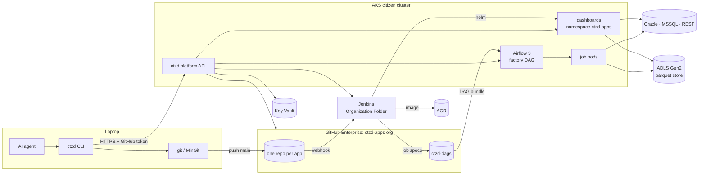
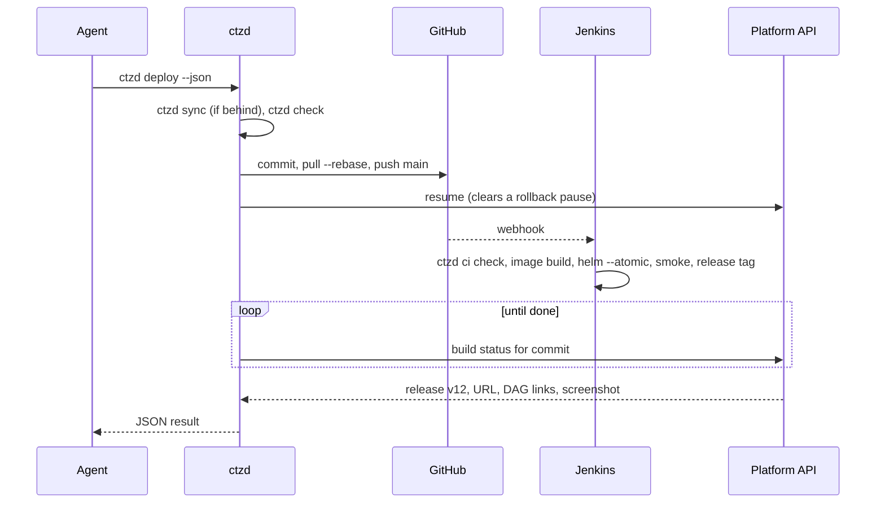

# ctzd platform plan

ctzd lets business users with no coding experience build Python dashboards and
scheduled jobs by talking to an AI coding agent, and get back a link to the
running app. The agent writes the code, runs the checks, and deploys. The user
never touches git, a pull request, a Dockerfile, or a terminal.

This page records the plan agreed on 2026-11-04: what users experience, how the
pieces fit, every decision with its reason, and the rollout. The Jenkins and
Kubernetes sections are proposals for the infrastructure owner to confirm or
change. All hostnames and organisation names here are `contoso` placeholders.
Version 0.1.0 of everything described here is implemented in this repository;
section 14 says what has and has not been run.

## 1. What a citizen developer experiences

1. They install the `ctzd` skill from the internal skills app, or paste one
   sentence from the platform landing page into their agent:
   *"Set me up for ctzd: run `powershell -c "irm https://ctzd.contoso.com/install.ps1 | iex"`
   and do what it prints."*
2. The agent runs the install script. A browser tab opens once and asks them to
   approve GitHub access. They click **Authorize**.
3. They describe what they want: *"Build me a dashboard of today's bond prices
   by sector from the FI pricing database."* The agent runs `ctzd new`, writes
   the data loader, the logic, and the page, starts it locally with `ctzd dev`,
   and shows it to them.
4. They say *"ship it"*. The agent runs `ctzd deploy` and replies with
   `https://fi-bond-prices.ctzd.contoso.com` and a screenshot of the live page.
5. They say *"email me the sector summary every weekday at 7"*. The agent adds a
   job with `ctzd add job`, deploys, and replies with the link to the job in
   Airflow.
6. They say *"yesterday's change broke the chart"*. The agent runs
   `ctzd rollback`; the previous version is live within seconds, and the agent
   then fixes the change and deploys again.

Power users may run git themselves. Pushing to `main` deploys exactly as
`ctzd deploy` does.

## 2. Architecture



| Component | Runs on | Owner | In this repo |
|---|---|---|---|
| `ctzd` CLI | laptops and Jenkins agents | platform team | `packages/ctzd-cli` |
| `ctzd-core` runtime library (`import ctzd`) | inside every app | platform team | `packages/ctzd-core` |
| `ctzd-<sbu>` libraries | inside that SBU's apps | SBU champion | `kits/<sbu>` |
| Platform API | AKS | platform team | `packages/ctzd-api` |
| App template and skills | copied into every app repo | platform team, SBU champion for SBU skills | `packages/ctzd-cli/src/ctzd_cli/assets` |
| Bootstrap skill for the skills app | laptops | platform team | `bootstrap/` |
| Install script | laptops | platform team | `install/install.ps1` |
| Base image | ACR | platform team | `images/base` |
| Airflow factory DAG | Airflow | platform team | `airflow/` |
| Jenkins shared library | Jenkins | infrastructure owner (proposal) | `jenkins/` |
| Helm chart | AKS | infrastructure owner (proposal) | `deploy/helm/ctzd-app` |

## 3. Decisions

| Area | Decision | Reason |
|---|---|---|
| Users | Business users with no coding experience, on Windows laptops without admin rights or git, using any AI agent. Claude Code is the primary agent. | That is the audience. Everything below assumes the agent does every technical step. |
| Repos | One repo per app. An app is at most one dashboard plus any number of scheduled jobs that share its data and logic code. | Clear ownership, small agent context, and the job-plus-dashboard pair is the main speed tool. |
| Template | No Copier. Platform files are byte-identical in every repo and `ctzd sync` overwrites them. The app's Python package is always `app`. | Locked files never need a merge, so a template engine adds nothing. One platform version per repo. |
| Locked files | CI fails when a platform-owned file differs from the platform version recorded in `.ctzd/version`. Agents edit only `src/`, `tests/`, `app.toml`, `README.md`, and the dependency list. | Stops an agent from "fixing" a lint error by editing the Dockerfile or the linter config. |
| SBU stacks | One `ctzd-<sbu>` library per SBU, depending on `ctzd-core`, declaring the SBU's package stack and shared loaders. All published to the internal PyPI. | SBU differences live in packages, not in templates. |
| Dependencies | Agents may add any package from the internal PyPI. No cooldown, no allowlist. | The internal PyPI is the control point. |
| Deploy | `ctzd deploy` runs the checks, commits, pushes to `main`, follows the Jenkins build, and prints the URL. Nothing is built on the laptop. | Laptops have no Docker or registry access; CI is the only path to production. |
| Lanes | One lane: `main` is production. Only builds that pass every gate deploy. | Simplest model for people who will never review a pull request. |
| Rollback | Every successful deploy is a numbered release (`ctzd/vN` git tag holding the image and config). `ctzd rollback` restores an earlier release in seconds and pauses auto-deploy until the next `ctzd deploy`. | Instant recovery without a rebuild; the pause stops the next push from bringing the bug back. |
| Failed rollouts | Helm `--atomic` with readiness probes; a release that never becomes ready is undone automatically. | Users never see a broken rollout. |
| Identity | One service identity for the whole platform. One read-only account per data source, mounted into every app pod. | Simplicity; the cluster is internal and isolated. Any app can read any SBU's data, so the SBU data boundary is a convention. |
| Dashboard access | No SSO and no auth on dashboards. | Internal network only; keep auth light. |
| Platform login | GitHub device flow (`ctzd login`, one **Authorize** click). The token authenticates git and the platform API. Push access to a repo authorises every action on that app. | One login people already have. |
| Local credentials | `ctzd env` writes the read-only credentials of the app's sources into a gitignored `.env`. | Lets the agent run the app against real data locally. |
| Git on laptops | `ctzd setup` installs MinGit when git is missing. `ctzd` drives git; power users may use git directly. | Business users never see git; power users keep full control. |
| Jobs | A dedicated Airflow 3 in the citizen cluster. One factory DAG generates a DAG per job from specs Jenkins writes to `ctzd-dags`. No DAG code in app repos. The Airflow UI has no login. | People already use Airflow and want its DAG UI link; DAG code is too easy to get wrong. |
| Job outputs | Parquet on ADLS Gen2 at `<sbu>/<app>/<table>/`, written atomically by cluster jobs only, with the last versions kept. No writes back to source systems. | A job precomputes slow queries; the dashboard reads parquet in milliseconds. |
| Notifications | `ctzd.notify.email` (SMTP relay, DataFrames attached as xlsx or csv) and `ctzd.notify.teams` (Workflows webhook). Owners get an email when a job fails. | "Send me X every Monday" is the most common job. |
| Data stack | pandas 3 is the default. Oracle through `python-oracledb` thin mode, MSSQL through `mssql-python`, both fetching through Arrow. REST through the `ctzd-core` client. Floats are fine for numbers. | Most data comes from REST, Oracle, and MSSQL. Thin mode needs no Oracle client; no source needs Native Network Encryption. |
| Code layout | `src/app/data/` (the only I/O), `src/app/logic/` (pure functions), `src/app/ui/` and `src/app/jobs/` (entry points), enforced by import-linter. | Agents physically cannot put a query in a page callback. |
| UI frameworks | Streamlit (default) and Dash, chosen at `ctzd new`. | Both are in use; only `ui/` differs. |
| Python standards | ruff with every rule, ty with every rule as an error, both handled by the agent. Light data validation: loader schemas check required columns and dtypes only. 70% branch coverage on `logic/`. | Strict where the agent pays the cost, light where it would slow people down. |
| Tests | `ctzd check` runs the same gates locally and in Jenkins. Jenkins adds a post-deploy browser smoke test with a screenshot. Platform code has ordinary test suites. No agent-driven evaluations. | One definition of "green". |
| Agent instructions | Repos carry `AGENTS.md` and `.agents/skills/` only. `ctzd` copies the skills into a gitignored `.claude/skills/` because Claude Code reads skills only from there. | Agent-neutral repos that every agent can read. |
| Skill distribution | The internal skills app carries one bootstrap skill, `ctzd`. Everything else ships in the repo, matched to the repo's platform version. | One update channel for the skills that must match the code. |
| Enforcement | `ctzd deploy` runs `ctzd check` first; Jenkins runs it again. An org-wide Claude managed setting denies reading `.env`. | Enforcement that works for every agent, without per-repo agent config. |
| Command output | Every command prints a short summary; `--json` returns the same facts for agents. Failures name the failing step and show the last log lines. | Agents act on structured output; people read the summary. |
| Dashboards at rest | Always on, small resource requests. Streamlit runs one process per pod; Dash runs gunicorn with 2 workers and 4 threads. | Simple; add scale-to-zero only if node costs demand it. |
| Logs | `ctzd logs` streams pod logs through the platform API; job logs live in Airflow. No log shipping in v1. | No Datadog in this cluster yet. |
| Lifecycle | `ctzd delete` removes the app after a 30-day grace period for its tables. Apps with no visits and no successful runs for 90 days get an owner email and are paused 30 days later. The SBU team inherits apps whose owner leaves. | Keeps the cluster from filling with abandoned apps. |
| Repo access | Internal visibility; the creator is admin; the SBU's GitHub team has write. | Colleagues can take over an app. |
| Folders | Users keep apps in any folder they like. | Their choice. |
| Ownership | Platform team owns the platform; each SBU names a champion who owns its library and SBU skill; data sources are added by the platform team on the champion's request. | Agents can never add a data source themselves. |

## 4. An app repository

```text
fi-bond-prices/
├── app.toml                 # app settings: the agent edits this
├── pyproject.toml           # dependencies: the agent edits [project].dependencies only
├── uv.lock
├── README.md
├── src/app/
│   ├── data/                # loaders: the only code that does I/O
│   │   ├── loaders.py
│   │   └── sql/*.sql        # one query per file, bind parameters only
│   ├── logic/               # pure functions: frames in, frames out
│   ├── ui/main.py           # the Streamlit or Dash entry point
│   └── jobs/<name>.py       # one module per scheduled job, each with main() -> int
├── tests/
├── .env.example             # written by ctzd sync from [sources].use
├── AGENTS.md                # locked
├── .agents/skills/          # locked
├── Dockerfile  Jenkinsfile  # locked
├── ruff.toml  ty.toml  .importlinter  pytest.toml  .python-version  # locked
├── .pre-commit-config.yaml  .gitignore  .gitattributes  .dockerignore  # locked
└── .ctzd/version            # platform version the locked files came from
```

Locked files are the platform's. `ctzd sync` rewrites them and the managed
tables of `pyproject.toml` (`build-system`, `requires-python`,
`dependency-groups.dev`, and `tool.uv`). `ctzd check` and Jenkins fail when any
of them differ from the recorded platform version.

`app.toml` holds everything Jenkins and Airflow need:

```toml
[app]
name = "bond-prices"
sbu = "fi"
ui = "streamlit"          # streamlit | dash | none
size = "s"                # s | m | l
owners = ["ann.lee@contoso.com"]

[sources]
use = ["fi_pricing"]      # sources ctzd env writes into .env

[[jobs]]
name = "sector_summary"
schedule = "0 7 * * 1-5"  # cron, UTC
size = "m"
retries = 1
timeout_minutes = 60
```

import-linter enforces the layers: `ui` and `jobs` may import `data` and
`logic`; `data` and `logic` never import each other or anything above them;
`logic` imports no I/O library and no `ctzd`; `ui` never imports a database
driver or HTTP client directly.

## 5. The ctzd command line

| Command | What it does |
|---|---|
| `ctzd setup` | Checks uv, git (installing MinGit on Windows when missing), the GitHub login, and the agent setup. |
| `ctzd login --start`, `ctzd login --wait` | GitHub device-flow login in two steps, because agents see output only when a command ends: `--start` returns the code to show the person, `--wait` blocks until they approve it. The token goes into the OS credential store. |
| `ctzd new NAME --sbu SBU --ui streamlit\|dash\|none` | Creates the GitHub repo through the platform API and writes the starter app into a new folder. `--offline` writes the files only. |
| `ctzd open NAME --sbu SBU` | Clones an existing app into a new folder. |
| `ctzd dev` | Runs the dashboard locally against real data. |
| `ctzd run JOB [--local]` | Runs a job in Airflow and prints the run link, or runs it locally. |
| `ctzd add job NAME --schedule CRON` | Adds a job module, its test, and its `app.toml` entry. |
| `ctzd check [--fix]` | Runs every gate. |
| `ctzd env` | Writes the app's read-only source credentials into `.env`. |
| `ctzd deploy` | Checks, commits, pushes, follows Jenkins, prints the URL, DAG links, and screenshot. |
| `ctzd status` | Current release, pause state, URL, DAG links, last build. |
| `ctzd logs [--job JOB] [--tail N]` | Recent dashboard or job log lines. |
| `ctzd releases` | Lists releases. |
| `ctzd rollback [vN]` | Restores a release and pauses auto-deploy. |
| `ctzd sync` | Rewrites locked files to the installed platform version. |
| `ctzd delete --yes` | Deletes the app. |
| `ctzd ci …` | Steps Jenkins calls: `check`, `render`, `release`, `smoke`. |

Every command accepts `--json`. Exit status is `0` on success, `1` on failure,
`2` on a usage error.



## 6. Data access

**Sources.** Each data source is one Key Vault secret, `ctzd-source-<name>`,
holding a JSON description of the source and its read-only account. The
platform syncs the secrets into the cluster and every app pod receives them as
environment variables named `CTZD_SOURCE_<NAME>`. `ctzd env` writes the same
variables into `.env` for the sources listed in `app.toml`. Supported kinds are
`oracle`, `mssql`, `rest` (no auth, bearer token, header key, basic, or OAuth
client credentials), and `teams` (a Workflows webhook). Adding a source is a
platform-team task.

**Queries.** Loaders call `ctzd.query("fi_pricing", "sql/prices.sql", {"as_of": day})`
and get a pandas DataFrame; decimals arrive as float64 and dates as datetime64.
SQL lives in files with bind parameters (`:name` for Oracle, `%(name)s` for
MSSQL) and selects only the columns it needs. REST loaders call
`ctzd.rest("fi_api").get_frame("/bonds", records="items")`, `get_json`,
`get_all_pages`, or `post_json`; the client applies timeouts, retries on
429 and 5xx, OAuth token refresh, and paging, and keeps connections open
between calls.

**Caching.** `@ctzd.cached(ttl="15m")` caches a loader's result in the process,
the same way in Streamlit and Dash. `ctzd-core` logs any dashboard loader slower
than 3 seconds; the skill tells the agent to move that query into a job.

**Store.** `ctzd.write_table(df, "sector_summary")` writes a new version of the
table and then flips its `_latest` pointer, so readers never see a half-written
table; `ctzd.read_table("sector_summary")` reads the latest version, and
`app=` reads another app's table. Locally, writes go to `.ctzd/out/`.

**Notifications.** `ctzd.notify.email(...)` and `ctzd.notify.teams(...)`.

**Validation.** `ctzd.require_columns(frame, {"isin": "str", "price": "float"})`
checks that the required columns exist with the expected dtype family (`str`,
`float`, `int`, `number`, `datetime`, `bool`, or `any`). Nothing heavier.

**Tests.** `ctzd.testing.fake_sources(fi_pricing={"sql/prices.sql": frame})`,
`fake_store(tmp_path)`, and `outbox()` replace sources, the store, and
notifications in tests; inside `fake_sources` any source that is not faked
fails, so a test never reaches a real system.

## 7. Quality gates

`ctzd check` runs, in order:

1. the locked-file drift check (locally it restores changed platform files and
   syncs an app whose platform version is older than the installed CLI);
2. `uv sync` (`uv sync --locked` in Jenkins);
3. `ruff format` and `ruff check --fix` (check-only in Jenkins), every rule;
4. `ty check`, every rule an error;
5. `lint-imports`, the layer contracts;
6. a parse of every `src/app/data/sql/*.sql` file as Oracle or SQL Server;
7. `pytest`, with branch coverage of `src/app/logic` at least 70%.

The starter tests include a Streamlit `AppTest` or Dash callback test that runs
the page against fake sources from `ctzd.testing`. Jenkins runs the same
`ctzd ci check`, and after the rollout a browser smoke test opens every page,
fails on an error box, saves a screenshot for the agent, and rolls the release
back if the page is broken.

## 8. Agent instructions and skills

Each repo carries a short `AGENTS.md` and these skills in `.agents/skills/`:

| Skill | Teaches |
|---|---|
| `ctzd-workflow` | The dev → check → deploy → status → rollback loop and reading `--json` output. |
| `ctzd-layout` | Where code goes, with worked examples. |
| `ctzd-data` | Sources, SQL files, caching, REST, pandas 3 pitfalls, moving slow queries into jobs, the store. |
| `ctzd-streamlit`, `ctzd-dash` | Page structure, speed, and UI tests for each framework. |
| `ctzd-jobs` | Job entry points, schedules, notifications, safe reruns. |
| `ctzd-testing` | What to test and how to build small test frames. |
| `python-standards` | The house Python rules, trimmed for this audience. |
| `ctzd-troubleshoot` | Reading Jenkins, Airflow, and pod failures, with common fixes. |
| `sbu-<sbu>` | The SBU's sources, glossary, and shared loaders. |

Codex, Copilot, Cursor, Gemini CLI, and OpenCode read `.agents/skills/`. Claude
Code reads `AGENTS.md` but loads skills only from `.claude/skills/`, so
`ctzd new`, `ctzd open`, `ctzd sync`, and every `ctzd check` refresh a
gitignored `.claude/skills/` copy. `ctzd setup`
warns when a `CLAUDE.md` in a parent folder would stop Claude Code from reading
`AGENTS.md`.

The internal skills app distributes only the bootstrap skill `ctzd`
(`bootstrap/skills/ctzd`), which covers setup, starting an app, and opening an
existing one.

## 9. Onboarding and distribution

`install.ps1`, run by the agent, puts uv in `~/.local/bin`, writes a user
`uv.toml` that points at the internal PyPI and an internal mirror of uv's
Python builds, runs `uv tool install ctzd`, and runs `ctzd setup`. Setup
installs MinGit when git is missing and reports whether the person still needs
to log in, which the agent then does with the two-step `ctzd login`. The uv,
MinGit, and Python downloads are served from the platform host, so laptops
need no access to github.com or pypi.org. Upgrading is `uv tool upgrade ctzd`;
an app whose platform version is newer than the installed CLI asks for it.

## 10. Jobs on Airflow

Jenkins renders `app.toml` into `specs/<sbu>/<app>.json` (image, release, owners,
and each job's schedule, size, retries, and timeout) and commits it to the
`ctzd-dags` repo. The factory DAG in that repo reads every spec and generates
one DAG per job, named `<sbu>__<app>__<job>`, each running
`python -m app.jobs.<job>` in the app's image with KubernetesPodOperator.
A failed run emails the app's owners through the SMTP provider's
`SmtpNotifier`, which needs Airflow's `smtp_default` connection. A spec that
fails to parse is logged and skipped so the other apps' jobs keep running.
Because the specs live in the same git repository as the factory DAG, a
GitDagBundle version pins both together. `ctzd deploy` prints each DAG's link
and `ctzd run` triggers a run and prints its link. The Airflow UI runs the
simple auth manager in all-admins mode. The factory is tested by loading it in
Airflow 3.3 (`airflow/tests`).

## 11. Jenkins and Kubernetes (proposals for the infrastructure owner)

- **Discovery.** One GitHub Organization Folder job scans `ctzd-apps` and
  builds every repo with a `Jenkinsfile`. The `Jenkinsfile` is
  `@Library('ctzd') _` plus `ctzdApp()`.
- **Pipeline.** `ctzdApp()` installs the CLI at the app's recorded platform
  version into a per-build venv, runs `ctzd ci check`, builds and pushes
  `contosoctzd.azurecr.io/apps/<sbu>-<app>:<sha>`, skips deploy if the app is
  paused, runs `helm upgrade --install --atomic` with values from
  `ctzd ci render`, commits the job specs to `ctzd-dags`, runs `ctzd ci smoke`
  against the live URL (running `helm rollback` and failing the build if the
  page shows an error), and finishes with `ctzd ci release`, which tags the
  commit `ctzd/vN`, and records the live release in the `ctzd-state-<sbu>-<app>`
  ConfigMap that the platform API reads. Branches other than `main` run the
  checks only.
- **Rollback job.** A parameterised `ctzd-rollback` job, triggered by the
  platform API, redeploys a release's image and config and sets the pause flag.
- **Branch protection.** `main` accepts direct pushes; force-pushes and
  deletion are blocked.
- **Cluster.** One `ctzd-apps` namespace. Sizes `s`, `m`, `l` map to
  0.5 CPU / 1 GiB, 1 CPU / 4 GiB, and 2 CPU / 8 GiB limits, with requests of
  0.1 CPU and 512 MiB. One replica per dashboard.
- **Ingress.** `https://<sbu>-<app>.ctzd.contoso.com` under one wildcard DNS
  record and one wildcard certificate.
- **Secrets.** Source secrets synced from Key Vault into one Kubernetes secret
  that every app pod and job pod mounts as environment variables.
- **Images.** ACR keeps the last 20 images per app, which bounds rollback.
- **Pipeline smoke test.** Platform CI builds a sample app of each kind through
  the real pipeline into a throwaway namespace.

## 12. Ownership

| Who | Owns |
|---|---|
| Platform team | `ctzd`, `ctzd-core`, the platform API, the template and common skills, the base image, Airflow, the install script, adding data sources |
| Infrastructure owner | Jenkins, the Helm chart, the cluster, DNS and certificates, secret sync |
| SBU champion | `kits/<sbu>` and the `sbu-<sbu>` skill, through CODEOWNERS with platform review |
| App owner | Their app, through their agent |

## 13. Rollout

| Phase | Scope | Exit gate |
|---|---|---|
| 0 | The platform team builds the platform and runs the spikes below. | A sample app of each kind deploys end to end. |
| 1 | FI (fixed income) pilots with 3–5 citizen developers building real apps. Skills are tuned from what goes wrong. | Pilot apps reach production without platform-team help. |
| 2 | All SBUs. | — |

Phase 0 spikes:

- `python-oracledb` thin-mode `fetch_df_all` and `mssql-python` `cursor.arrow()`
  against one real source each, over the company network with TLS (already run
  against local Oracle 23 Free and SQL Server 2022 containers; see section 14);
- Airflow 3: the UI link format (`/dags/<dag_id>/runs/<run_id>` is assumed),
  the trigger request body, and API tokens in all-admins mode;
- a Claude Code managed deny rule that matches `.env` in every project;
- whether Claude Code loads `AGENTS.md` and skills when the agent works in an
  app subfolder;
- GitHub Enterprise device flow for the `ctzd` OAuth app;
- MinGit and uv on a locked-down laptop, and uv's Python downloads from an
  internal mirror.

## 14. Implementation status

Built and verified in this repository on 2026-11-04:

- the CLI, `ctzd-core`, and the platform API, with their test suites, under the
  house ruff and ty configuration;
- one app of each kind (Streamlit, Dash, jobs only) generated by `ctzd new`
  and passing every `ctzd check` gate (`scripts/e2e.sh`);
- app images built on the base image, run as the non-root user, and checked by
  `ctzd ci smoke`, which also caught a page that raises;
- the Helm chart linted and rendered with `ctzd ci render` output;
- the factory DAG loaded by Airflow 3.3.2 with the Kubernetes provider 10.25;
- the job-spec publisher run against a local git repository;
- `ctzd.query` against Oracle 23 Free (thin mode) and SQL Server 2022 in local
  containers (`scripts/driver-spike.sh`): 200,000 rows in 0.18 s and 0.09 s,
  named binds on both, decimals as float64, dates as datetime64, nulls kept.
  Oracle reports unquoted column names in upper case, so `ctzd.query`
  lower-cases them, as SQLAlchemy does.

Written but not yet run against real systems: the platform API's GitHub,
Jenkins, Airflow, Kubernetes, and Key Vault clients; the Jenkins library and
jobs; the device-flow login; the drivers over the company network; the store on
ADLS; `install.ps1` and MinGit on Windows.

## 15. Open items

- The FI package stack, first sources, and pilot apps.
- Rough numbers of SBUs, citizen developers, and apps for sizing Airflow and
  the cluster.
- Whether Excel users need job outputs in a SQL table; if so, add an MSSQL
  output database.
